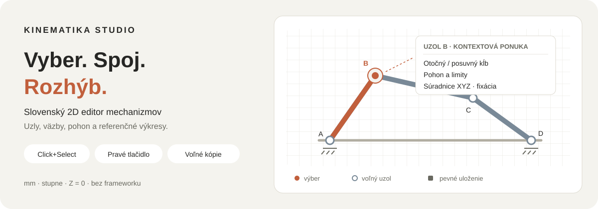

# Kinematika Studio

[](https://github.com/bucala/Kinematicke_modely/actions/workflows/ci.yml)
[](LICENSE)

**Navrhnite geometriu. Spojte uzly. Rozhýbte mechanizmus.**

Slovenské webové štúdio na tvorbu, analýzu a simuláciu rovinných mechanizmov. Bez frameworku a bez inštalácie balíkov. Rozmery v **mm**, uhly v **°**, rovina **Z = 0**.

[](#start)

*Ilustračná schéma, nie snímka aplikácie. Kliknutím prejdete na spustenie.*

**[Rýchly štart](#start)** · **[Stiahnuť zdrojový ZIP](https://github.com/bucala/Kinematicke_modely/archive/refs/heads/main.zip)** · **[Ovládanie](#controls)** · **[História zmien](CHANGELOG.md)** · **[Výsledky overenia](VALIDATION.md)** · **[MIT licencia](LICENSE)**

> Kinematika a odhadová dynamika jedného pohonu, nie pevnostný výpočet ani výrobný výkres. Pred použitím návrhu si prečítajte [hranice simulácie](#limits).

## 2.5.0: pevné zostavy a prehľadnejšia montáž

Vyberte aspoň dve samostatné telesá cez **Shift + klik** na plátne alebo v strome; na mobile zapnite **Výber → Vybrať viac dielov**. Zvoľte **Spojiť napevno**, pomenujte zostavu a potvrďte. Diely zachovajú zobrazenú vzájomnú polohu a pohybujú sa spolu. **Rozpojiť zostavu** obnoví samostatné telesá a pôvodné vnútorné väzby; vonkajšie spoje sa zachovávajú. Každá operácia má jeden krok Späť a zostava sa prenáša súborom `.kinmo` aj knižnicou. Pohyblivé vedenia, pružiny a piesty spájajte cez ich montážne telesá; pred spojením programovaných pohonov vypnite časový program.

Motor má jeden rozbaľovací riadok s kopírovaním a odstránením celej zostavy. Režimy **Montáž / Pohon** vyberú kryt alebo rotor a zobrazia príslušné body. **Základné ovládanie** ponúka bežné úpravy, **Pokročilé ovládanie** sprístupní úplné vlastnosti. Body sa v základnom režime ukazujú pri výbere, prejdení myšou a spájaní. **Izolovať výber** dočasne zobrazí vybrané telesá a ich diely; **Zobraziť všetko** obnoví pohľad bez zmeny modelu.

**Overiť motor** porovná vzorkovaný potrebný moment a rozbeh s menovitým momentom na výstupe prevodu. Zobrazuje rezervu a umožňuje zapnúť zastavenie prehrávania pri preťažení. Vyžaduje jeden rotačný motor a určený mechanizmus. Je to odhad z hmotností, gravitácie, pružín, tlmičov, trenia a zotrvačnosti, bez elektrických prechodov, tepelného modelu a katalógovej momentovej krivky.

Magic import rozlišuje **telesá → vlastníctvo otvorov → väzby → skúšku pohybu**. Otvor jednoznačne vo vnútri telesa vytvorí montážny bod bez ďalšieho ložiska. Neisté kruhy používateľ priradí na očíslovanej predlohe k telesu, spoločnému čapu, samostatnému ložisku alebo ich vynechá. Navrhnuté väzby sa vkladajú iba po výslovnom výbere. Skúška použije dočasný pohon okolo potvrdeného pevného čapu v piatich polohách 0–30°; nevkladá odhadnutý pohon do projektu a nepreukazuje celý cyklus. Ak chýba pevný čap, pomenuje chýbajúce uloženie.

## 2.4.1: jednoduchá editácia motora

Motor má samostatnú ikonu a technický symbol s rebrami, svorkovnicou a pätkami. Po výbere krytu alebo rotora sa zobrazuje **jeden úchyt priemeru Ø**, nie vrcholy obrysového mnohouholníka. Teleso presuniete ťahaním, presnú polohu a uhol zadáte v dolnej lište. **Parametre elektromotora** obsahujú výkon, napätie, otáčky a rozmery; **Spojenia / uloženie** slúžia na pripojenie montážnych bodov. Zmena priemeru z krytu aj z rotora zachová stred hriadeľa a má jeden krok Späť. Technický symbol je zobrazenie pre schému, nie výrobný 3D model.

## 2.4.0: kryt a rotor motora, náhľad opráv a prekryté body

Nový elektromotor má **samostatný kryt a rotor**. Cez **Vlastnosti → Kryt a montážne body** vyberte kryt a jeho úchyty A/B alebo stred C pripojte k rámu. Os A rotora spojte napevno s poháňaným ramenom alebo vačkou; čap B rotora použite pre ojnicu. Potom na rotore zvoľte **Zapnúť motor**. Kryt má vlastné uloženie, takže jeho pevné spojenie neblokuje otáčanie hriadeľa. Rovnaké tlačidlo pripraví kryt aj pre starší motor bez prepisovania pôvodných väzieb. Presúvanie motora, zmena priemeru a duplikovanie zachovávajú zostavu; kryt aj rotor sa ukladajú do `.kinmo`.

V **Ďalšie nástroje → Prečo sa nehýbe?** vyberte konkrétny problém. Návrhy na uvoľnenie otáčania, odstránenie nadbytočnej väzby, preverenie dorazu alebo úpravu zdvihu najprv ukážu **náhľad pred/po**. Overte zmenený počet nesplnených väzieb a voľných súradníc a potvrďte **Použiť opravu**. Model sa pred potvrdením nemení; Späť obnoví pôvodný stav. Návrh sa týka aktuálnej polohy bez kolízií, celý cyklus skontrolujte samostatne.

Pri prichytení na prekryté uzly vyberte číslo v **zväčšenom okolí bodov** alebo jeho názov v zozname. Potom zvoľte **Vložiť otočný čap**, **Spojiť napevno**, vhodné vedenie alebo **Iba zarovnať**. Poloha a spojenie zostávajú jedným krokom Späť.

## 13. 10. 2026: prichytávanie, vačka a úpravy kriviek

Rozšírenie zdrojov nad `5e9798b` pridáva:

- **[Spoločné prichytávanie](#snapping)** pri ťahaní aj vkladaní: uzly, osi/strednice, hrany a viditeľné trajektórie. Samostatné tlačidlo **Sieť 5 mm** vypína iba zaokrúhľovanie, nie inteligentné prichytávanie ani kreslenú mriežku.
- Voľné konce pružín a tri montážne body vozíka **C / CT / CB**, aj v otočenom vedení a pôvodných šablónach.
- **[Rotačnú vačku s vedeným valčekom](#cam)** a kontaktom podľa skutočného polomeru valčeka.
- **[Magic import podľa obrysov a spojitosti](#magic-import)**, so zachovaním konkávneho obrysu a bez automatického určovania mechanickej funkcie podľa farby.
- Pravý klik na časť vybraného telesa zachová zvýraznenie skupiny, ale ponuka cieli presný bod, vrchol alebo dráhu. Pravý klik na pozadie výber neruší.
- **[Bézierove riadiace body P0 až Pn a presný polkruh s R](#curves)**, s lokálnymi súradnicami a atómovým Späť/znova.

Syntax, **591 JavaScriptových testov** a statický build prešli aj pri predpublikačnej kontrole 13. 10. 2026. Zdieľaná prehliadačová sada pri funkčnom overení 12. 10. prešla **362 / 362** cez HTTP aj offline `file://`. Natívne gestá, syntetický drop a hranice rozpoznávania sú rozlíšené v [VALIDATION.md](VALIDATION.md). Commit a push zdrojov nepotvrdzujú úspešné vzdialené CI ani produkčné nasadenie; tie treba overiť samostatne.

## Publikované 12. 10. 2026: mierka, detekcia, projekty a inteligentné kóty

Commit `5e9798b` nad `6554b75` pridáva **mierku obrázka z jedného rozmeru X/Y/A–B**, voliteľné lokálne geometrické návrhy v kroku **2.5**, bezpečné číselné dialógy, duplikovanie a potvrdené mazanie projektov, samostatnú analýzu celého pohybu a spoľahlivejší výber/pravé menu.

**[Kóty a presné vstupy](#handles)** prijímajú výrazy a jednotky, dva body možno vybrať na plátne a zmenou dĺžky zachovať A, B alebo stred, aj pri zobrazenom pohone. **[Profil a prehrávanie](#view-controls)** začínajú skryté; ich prepínače sú pri diagnostike.

Klik mimo číselného dialógu nestratí rozpísaný vstup. Pravá ponuka sprístupní aj prekryté prvky a vymazanie konkrétneho kĺbu alebo kóty ponechá označené telesá. Zapnutie autodetekcie zachová rozpracovanú kalibráciu; návrhy vložíte až po kontrole, jedným krokom Späť.

Predchádzajúci commit `6554b75` obsahuje prepínače popisov/panelov, skutočnú schému plátna v PDF a **[lokálny animovaný GIF](#gif-export)**. Git commit alebo push nepotvrdzuje úspešné produkčné nasadenie; stav CI a Workers Builds treba overiť samostatne.

## Novinky z 11. 10. 2026

- **[Magic import](#magic-import):** nahrajte náčrt, určte mierku A/B, obkreslite pevné časti, vložte členy a väzby a vytvorte samostatný projekt cez Finish. Obrázok zostáva lokálny; ide o ručné obkreslenie.
- **[Presné úchyty](#handles)** a **[diagnostika väzieb](#diagnostics)** priamo v editore, s oddelenými chybami v mm/°.
- **[Inteligentné prichytávanie](#snapping)** je predvolene vypnuté, zapína sa iba tlačidlom a nový spoj potrebuje potvrdenie.
- **[Vlastné podzostavy](#assemblies)** a **[pomenované verzie](#versions)** s prenosnými kolekciami, porovnaním a zálohou pred obnovením.
- **[Referenčné obrysy drážok](#slot-outlines)** pre DXF/Fusion bez straty stredníc.

Podrobný záznam noviniek, opráv a hraníc je v **[CHANGELOG.md](CHANGELOG.md)**.

<a id="navigation"></a>

## Vyberte, čo potrebujete

| Začínam používať | Chcem upravovať | Chcem preniesť alebo overiť |
|---|---|---|
| [Spustenie](#start) | [Úprava geometrie a voľné kópie](#editing) | [Súbory a reporty](#exports) |
| [Prvých pár minút](#quickstart) | [Výber a kontextové menu](#selection) | [Autodesk Fusion](#fusion) |
| [Šablóny mechanizmov](#templates) | [Skratky a ovládanie](#controls) | [Lokálne testy a vývoj](#development) |
| [Dvojite sklopeny suflik](#drawer) | [Pružiny a odhadová dynamika](#forces) | [GitHub a Cloudflare](#deployment) |
| [Časté otázky](#faq) | [Ukladanie a súkromie](#storage) | [Súbory projektu](#files) |
| [Úchyty a presné rozmery](#handles) | [Diagnostika väzieb](#diagnostics) | [Referenčné obrysy drážok](#slot-outlines) |
| [Prichytávanie na požiadanie](#snapping) | [Vlastné podzostavy](#assemblies) | [Pomenované verzie a porovnanie](#versions) |
| [Magic import z náčrtu](#magic-import) | [Mierka a pevný rám](#magic-import) | [Bezpečné Finish alebo zrušenie](#magic-import) |
| [Skrytie panelov a popisov](#view-controls) | [Aktuálny výrez do PDF](#exports) | [Animovaný GIF](#gif-export) |
| [Bézierove body a polkruh s R](#curves) | [Rotačná vačka a valček](#cam) | [Hranice kontaktu](#limits) |

Kliknutím na názov rozbaľovacieho návodu ho otvoríte. Navigácia a návody fungujú priamo na GitHube, bez JavaScriptu.

Pri prvom otvorení začína editor prázdny. Uložený projekt sa obnoví bez zmeny. Jedinú ponuku **Mechanizmy a projekty** otvoríte kliknutím na **názov projektu so šípkou v hlavičke**. Obsahuje všeobecné šablóny, samostatný projekt **Dvojite sklopeny suflik**, uložené projekty, **Magic import**, import, premenovanie, vlastné podzostavy a pomenované verzie.

Každý projekt možno **duplikovať** alebo **vymazať po potvrdení**. Kópia dostane nové ID a zachová aktuálne neuložené úpravy. Zmazanie otvoreného projektu otvorí prázdny neuložený editor a zastaví staré automatické ukladanie. Pred zmazaním si dôležitý projekt exportujte. Limit 20 projektov ani poškodené úložisko nespôsobia automatické vymazanie starších záznamov.

<a id="start"></a>

## Spustenie

<details open>
<summary><strong>Bez inštalácie: stiahnuť, rozbaliť a otvoriť</strong></summary>

1. [Stiahnite zdrojový ZIP](https://github.com/bucala/Kinematicke_modely/archive/refs/heads/main.zip) alebo použite vlastný klon repozitára.
2. ZIP rozbaľte. Súbory a priečinky ponechajte spolu.
3. Otvorte `index.html` v aktuálnom Chrome, Edge alebo Firefox.
4. V hlavičke kliknite na **názov projektu so šípkou** a vyberte šablónu alebo vlastný mechanizmus.

Aplikácia používa klasické skripty, preto funguje aj cez `file://`. Pri otvorení súboru na GitHube sa zobrazí jeho zdroj, nie spustená aplikácia. Webové fonty sú voliteľné a majú systémový fallback; PDF modul aj jeho fonty sú lokálne.

Priame prepojenie s Fusion potrebuje [lokálny server alebo HTTPS](#fusion). Ostatné projektové a výkresové exporty fungujú aj bez servera.

</details>

<details>
<summary><strong>Lokálny server: Node.js 20.11 alebo novší</strong></summary>

V termináli otvorte koreň tohto repozitára a spustite:

```sh
npm run dev
```

Otvorte **[http://localhost:5173](http://localhost:5173)**. Balíky netreba inštalovať. Server počúva iba na lokálnom rozhraní; zastavíte ho cez Ctrl+C. CI používa Node.js 24 podľa [`.node-version`](.node-version).

Lokálny odkaz je dostupný až po spustení servera. Pre Fusion použite presne rovnaký pôvod aplikácie ako v adresnom riadku; `localhost` a `127.0.0.1` nie sú rovnaký Origin.

</details>

[Späť na navigáciu](#navigation)

<a id="quickstart"></a>

## Prvých pár minút

<details>
<summary><strong>Prezrieť hotový mechanizmus a vytvoriť vlastnú kópiu</strong></summary>

1. Kliknite na **názov projektu so šípkou v hlavičke → Štvorkĺbový mechanizmus**.
2. Vyberte **Simulácia**. Posuvníkom skúmajte polohy alebo medzerníkom spustite prehrávanie.
3. Kliknite na uzol alebo člen. Skúste **Shift + klik** na ďalší objekt a pravé tlačidlo.
4. Ak chcete meniť chránenú geometriu, zvoľte **Voľná kópia**. Originál zostane samostatný.
5. V **Úprave geometrie** upravte kópiu; potom v **Simulácii** overte jej väzby a upozornenia.
6. Cez **Exportovať → .kinmo** vytvorte prenosnú zálohu. Lokálne uloženie cez Ctrl/Cmd+S samo nevytvorí súbor.

</details>

<details>
<summary><strong>Vytvoriť vlastný bod s posuvným kĺbom a lineárnym pohonom</strong></summary>

1. V hlavičkovej ponuke otvorte **Vlastný mechanizmus**.
2. Pravým kliknutím na prázdne plátno pridajte samostatný voľný uzol.
3. Na uzle otvorte **Posuvný kĺb po vedení…**.
4. V dialógu kliknite na **Pridať nové lineárne vedenie**. Vznikne pevné priame vedenie od polohy uzla. Vyberte jeho dráhu a potvrďte **Použiť**.
5. Na uzle otvorte **Priradiť / upraviť pohon…** a nastavte:

   | Pole | Hodnota |
   |---|---|
   | Typ | Lineárny |
   | Rýchlosť | `40` mm/s |
   | Smer | `0`° |
   | Začiatok / koniec zdvihu | `0` / `100` mm |

6. Potvrďte, prepnite na **Simulácia** a spustite prehrávanie. Pri opakovaní sa smer na konci zdvihu obráti.

Toto je kinematický príklad. Nový bod má predvolene nulovú hmotnosť; samotný príklad preto nie je pripravený na odhadovú dynamiku. `v = 0` drží polohu. Záporné `v` určí počiatočný opačný smer.

</details>

[Späť na navigáciu](#navigation)

<a id="features"></a>

## Funkcie

<details>
<summary><strong>Rozbaliť celý prehľad funkcií</strong></summary>

- Knižnica prvkov: samostatný bod, pevný rám, lineárne vedenie, tiahlo, kulisa, rotačná vačka, ložisko, čelo, tlačná/ťažná pružina a tlačný/ťažný piest.
- Click+Select bodov, koncov členov, väzieb a telies; Shift/Ctrl multiselect, skupinový posun a kontextové menu.
- Pridávanie kliknutím alebo drag & drop, prichytávanie na mriežku, zarovnanie, zoom a meranie.
- **Magic import**: lokálny obrázok, jednotná mierka z jednej známej hodnoty X/Y/A–B, voliteľné geometrické návrhy, ručne opravený rám, členy a väzby, samostatný projekt cez Finish.
- Priame úchyty X/Y, otočenie okolo zvoleného bodu, dĺžka jednoduchého člena a presné číselné zadanie bez otvárania Vlastností.
- Samostatná diagnostika konkrétnych väzieb, oddelené chyby v mm/°, zostávajúca voľnosť a upozornenia na opakované alebo konfliktné požiadavky.
- Inteligentné prichytávanie pri ťahaní aj drop: body, strednice, hrany a viditeľné trajektórie, **iba po zapnutí tlačidlom**. Samostatná sieť 5 mm. Nový spoj vyžaduje ďalšie potvrdenie.
- Otočný kĺb, posuvný kĺb, čap vo vedení, vačkový kontakt, pevné spojenie, vzdialenosť, rovnobežnosť a relatívny uhol; upraviteľný názov, uzly a hodnota.
- Inšpektor rozmerov, polohy, uhlov, ložísk, pohybových limitov a kontrolných bodov.
- Ručné ťahanie výsuvu a čela s inverzným kinematickým výpočtom.
- Automatický pohon, nastavenie rýchlosti, trvania cyklu, opakovania a presnej polohy.
- Parametrická kulisa, oblúk, presný polkruh s R, Bézierova krivka so všetkými 2–32 riadiacimi bodmi, spline a polyline; samostatné identity bodov, nosné teleso a polygonálny obrys.
- Vizualizácia troch polôh a trajektória ľubovoľného dostupného uzlového bodu.
- Živý graf pohybového profilu; kliknutím na graf sa nastaví poloha.
- Nezávislé skrytie profilového grafu a prehrávania časovej osi, s trvalo dostupnými tlačidlami na obnovenie.
- Vypnutie vizuálnych názvov, textov a uhlových anotácií schémy bez zmeny kót, geometrie alebo väzieb.
- Detekcia nedosiahnuteľných väzieb, nesprávneho priemeru ložiska, kríženia ramien a kolízie s korpusom.
- Späť/znova, duplikovanie, pomenovanie a viditeľnosť prvkov.
- Oddelená úprava geometrie a simulácia; samostatná voľná kópia ponechá parametrický originál nezmenený.
- Uložené referenčné a riadiace kóty, pomenované trajektórie a prevod platnej vypočítanej trajektórie na nezávislú vodiacu krivku.
- Sily pružín/piestov, hmotnosť, ťažisko, zotrvačnosť, gravitácia, tlmenie, trenie a jeden vonkajší pohon; odhadová dynamika.
- Automatické lokálne ukladanie, zoznam projektov, validovaný import `.kinmo` aj staršieho JSON.
- Prenosná knižnica vybraných podzostáv s vnútornými väzbami a nezávislými kópiami pri vložení.
- Pomenované verzie, obnovenie so zálohou aktuálneho stavu a porovnanie návrhových rozmerov.
- Export `.kinmo`, JSON, CSV, SVG v mm, PNG, animovaného GIF, DXF a lokálne vytvoreného PDF/HTML reportu.
- PDF so skutočnou ostro vykreslenou schémou, vyberateľným slovenským textom a vektorovými grafmi.
- Tri trvalé vzhľady: biela/čierna, krémová/terakota a teplá tmavá/biela.
- Voliteľný lokálny doplnok Autodesk Fusion na vytvorenie nového referenčného dokumentu.
- DXF/Fusion strednice aj voliteľné uzavreté referenčné obrysy drážok podľa šírky, vrátane vnútorného obrysu uzavretej strednice.
- Samostatný dvojkulisový projekt podľa náčrtu, obe trajektórie v sústave korpusu alebo zásuvky a viditeľné odhadové predpoklady.
- Responzívne rozhranie a klávesové skratky.

</details>

<a id="magic-import"></a>

## Magic import: od ručného náčrtu k mechanizmu

**Názov projektu → Mechanizmy a projekty → Magic import** otvorí päťkrokového sprievodcu s voliteľným medzikrokom **2.5**. Ručné obkreslenie možno doplniť lokálnou detekciou jednoduchých geometrických kandidátov. **Nejde o zaručené rozpoznanie funkcie mechanizmu.** Vytvára samostatný vlastný projekt a funguje aj offline cez `file://`.

<details>
<summary><strong>Nahrať náčrt, určiť mierku a zostaviť schému</strong></summary>

1. **Obrázok:** nahrajte PNG, JPG alebo neanimovaný WebP, prípadne ho pustite na sprievodcu či plátno. Limit je 10 MB, 8 192 px na stranu a 16 miliónov pixelov. SVG, GIF a HEIC najskôr preveďte na podporovaný raster.
2. **Mierka:** kliknite na body **A a B** a vyberte, či poznáte celú dĺžku **A–B**, vodorovný rozmer **X** alebo zvislý rozmer **Y**. Zadajte iba túto jednu hodnotu v **mm**. Druhý smer a celá šírka/výška obrázka sa prepočítajú rovnakou mierkou, bez zmeny pomeru strán. Súradnice možno zadať aj číselne. Bod A bude začiatkom; X rastie doprava a Y nadol.
   - **Voliteľný krok 2.5:** zapnite automatický návrh, spustite detekciu a skontrolujte náhľad. Prepnutie zachová aj rozpísané kalibračné súradnice. Vyberte iba vhodných kandidátov a opravte ich typy. Až tlačidlo na vloženie zmení geometriu jedným krokom Späť. Voliteľne spojte blízke konce; pohon sa nikdy nepriradí automaticky. Krok možno preskočiť.
3. **Pevné časti:** dvoma kliknutiami vytvorte pevnú úsečku/podlahu. **Obrys rámu** kreslite po vrcholoch a uzavrite Enter, tlačidlom alebo kliknutím pri prvom bode. **Pevný bod** vytvorí nepohyblivý uzol. Obrys má najviac 64 vrcholov; ďalšie vrcholy ponúknu uzly na pripojenie členov.
4. **Členy a väzby:** na desktope pretiahnite prvok z knižnice. Na dotykovom zariadení otvorte knižnicu, vyberte typ a kliknite na bod vloženia. Rameno, čelo alebo priame vedenie môžete aj obkresliť dvoma koncami. Upravte voľné členy úchytmi alebo číselným dialógom; **Spojiť uzly (J)** prepojí dva body a **Typ / nová väzba…** nastaví požadovaný typ. **Pohon…** upraví jeden vybraný vstup.
5. **Dokončenie:** zadajte názov, prezrite počty a upozornenia a kliknite na **Finish**. Schéma ostane v editore ako samostatný projekt. Potom prepnite na simuláciu a overte funkciu väzieb.

Pri prekrývajúcich sa uzloch vyberte prvý bod a kliknite znova na rovnaké miesto: druhý bod spojenia musí patriť inému členu. Pravé menu ponúkne aj **Vybrať entitu pod kurzorom**. Na nastavenie pohonu vyberte telo člena mimo spoločného uzla, potom jeho koniec v podponuke **Priradiť pohon**.

Vlastnosti sa samy neotvoria. Inteligentné prichytávanie začína vypnuté a zapína sa iba tlačidlom. Pri kreslení Ctrl/Cmd+Z alebo Backspace odoberie posledný rozkreslený vrchol; Escape zruší náhľad. Dokončené časti používajú bežné Späť/znova.

Vyberte dlhý známy úsek, aspoň 2 pixely. Známy rozmer musí byť 0,1–5 000 mm a celý kalibrovaný podklad sa musí zmestiť do rozsahu ±5 000 mm. Jedna mierka **neopravuje perspektívu, natočenie roviny ani skreslenie objektívu**. Kalibrácia neotáča obrázok. Fotografia šikmo odfotenej zostavy nie je presný technický výkres.

Pri náčrte s viacerými polohami kliknite v kroku 2.5 na **Vybrať oblasť · 2 rohy** a označte protiľahlé rohy jednej polohy, bez legendy. **Celý obrázok** zruší výrez; Escape zruší rozpracovaný výber. Kalibrácia zostáva spoločná pre celý obrázok. Menší výrez poskytuje viac detailov pri rovnakom limite rastra.

Detekcia vychádza zo spojitého tvaru, vonkajšieho obrysu a priebehu strednice, nie z farebnej identity súčiastky. Doplnkový priechod rozlišuje oblasti uzavreté hranami aj úzke biele vnútorné pásy obrysového náčrtu. Kruhové otvory navrhujú montážne body vo vnútri ramena alebo čela; tieto body sa pohybujú s telesom a môžu tvoriť otočné spoje mimo koncov A/B. Náhľad ich označí krúžkami a pri každom telese ich možno vypnúť. Pri ráme sú predvolene vypnuté: okolité čapy nemusia byť pevné ani patriť k rámu. Rozpoznaný konkávny obrys rámu/ramena/čela sa prenesie v kalibrovanej mierke. Tenká zakrivená dráha ostáva spojitou lomenou strednicou. Rozvetvené alebo nejasné tvary sa nepredvyberajú; doplnkové návrhy podľa hrán pri prekrytí majú nízku dôveru. Farba je vzhľad, nie dôkaz fixácie, pohonu alebo funkcie.

Detekcia používa zmenšený raster do 768 × 768 px, najviac 4 000 komponentov, 8 192 bodov jednej kontúry, 240 pracovných návrhov a 60 výsledných kandidátov. Zjednodušovanie má samostatný pracovný limit. V textoch, legendách, prekrytých čiarach a neostrých fotografiách môže navrhnúť nesprávne alebo chýbajúce prvky. Typ, konce, pevné časti a väzby musí skontrolovať používateľ; ručné nástroje ostávajú dostupné.

Pri historickej kontrole pred rozšírením detekcie pribaleného náčrtu s troma polohami a legendou vzniklo 10 návrhov, z toho 6 predvybraných. Pracovný postup, vloženie a Späť fungovali, ale návrhy správne nezrekonštruovali obe kulisy a rameno. Tento obrázok preto vyžaduje ručnú opravu alebo obkreslenie, nie slepé prijatie automatického výsledku.

</details>

<details>
<summary><strong>Čo zachová Finish a ako bezpečne zrušiť import</strong></summary>

- Počas sprievodcu sa rozpracovaná schéma automaticky neukladá medzi hotové projekty a neprepisuje predvoľby. Geometriu možno samostatne exportovať do `.kinmo` v poslednom kroku.
- **Zrušiť** po kreslení vyžaduje potvrdenie a obnoví pôvodný projekt, výber a celú históriu. Rozpracovaná schéma sa zahodí; ak bol pôvodný projekt neuložený, pokračuje jeho bežné ukladanie.
- **Finish** uloží nový aj potrebný pôvodný projekt oddelene. Pri plnom alebo poškodenom úložisku nevymazáva staršie záznamy. Ak pôvodný stav ešte nie je zachovaný, najskôr ponúkne jeho export a vyžiada potvrdenie zálohy. Dokončenie bez dostupného úložiska ostane iba v pamäti: nový projekt exportujte.
- Obrázok zostáva lokálny. **Finish uloží zmenšený prvý obrázok a jeho kalibrovanú polohu do projektu a `.kinmo`/JSON.** Tlačidlo Predloha ho prepína; nastavenia upravia priehľadnosť a zarovnanie. Pri staršom Magic projekte možno pôvodný obrázok doplniť bez prestavby modelu. CAD a čisté obrazové exporty predlohu neobsahujú.
- Mierku možno upraviť aj po kreslení. Náhľad ukáže pomer starej/novej mierky a zmena vyžaduje potvrdenie prepočtu všetkej geometrie a lineárnych parametrov. Uhly, hmotnosti a sily sa nemenia. **Späť/znova** obnovia mierku aj geometriu spolu. Výmena samotného obrázka naďalej vyžaduje potvrdenie čistej schémy; existujúca geometria sa vymaže až po úspešnom načítaní nového podkladu.
- Finish dokončuje geometriu, **nezaručuje správny pohyb ani určitý model**. Upozornenia na chýbajúci pohon, voľné členy alebo konfliktné väzby možno riešiť aj po dokončení.

</details>

[Späť na navigáciu](#navigation)

<a id="drawer"></a>

## Samostatný projekt: Dvojite sklopeny suflik

Otvorte **názov projektu so šípkou v hlavičke → Dvojite sklopeny suflik**. Obe zakrivené kulisy sa posúvajú so zásuvkou. Modré rameno má pevnú dĺžku a ložiská A/B pevný rozstup. Model najprv sklopí čelo z 90° na odhadových 65° počas 60 mm zdvihu, potom pokračuje spoločným posuvom do 300 mm bez zmeny uhlov.

| Výsuv | Uhol čela | Fáza |
|---|---|---|
| 0 mm | 90° | Zatvorené |
| 60 mm | 65° | Dokončené sklopenie |
| 300 mm | 65° | Spoločný posuv, otvorené |

Trajektórie zobrazujú oba vodiace body. V sústave zásuvky ležia v jej kulisách a po sklopení sa už nepredlžujú; v sústave korpusu zahŕňajú aj posuv. Graf obsahuje uhol čela aj ramena. CSV export pridáva obe ložiská v oboch sústavách, uhol ramena, fázu a označenie odhadových rozmerov.

**Geometria je odhadová, nie výrobný výkres.** Zadná opora, plynulé uvoľnenie čapu a pevný výrez stola sú doplnené predpoklady, nie zmerané detaily. Rozmery aj oba profily možno upraviť v inšpektore; nezlučiteľné kulisy vyvolajú blokovanie. Každé otvorenie pripraveného projektu vytvorí nový exemplár a neprepíše predchádzajúce úpravy.

Podrobný rozbor a pôvodný náčrt: [`projects/dvojite-sklopeny-suflik.md`](projects/dvojite-sklopeny-suflik.md). V aplikácii ich otvoríte cez **Odhadové rozmery · predpoklady**.

<a id="templates"></a>

## Šablóny mechanizmov

<details>
<summary><strong>Výsuv s vyklápacím čelom</strong></summary>

Východiskový korpus a vedenie majú dĺžku 390 mm, zdvih 300 mm a čelo dĺžku 160 mm. Ložisko je 65 mm od otočného čapu. Čelo zostáva vertikálne do posuvu 110 mm a následne sa plynulo vyklopí z 90° na 0°.

Pri parametrickom profile sa referenčná strednica drážky odvodí z dráhy ložiska podľa hladkého pohybového zákona. **Pri každej polohe solver rieši priesečník tejto drážky s kružnicou, ktorej stred je otočný čap a polomer je vzdialenosť ložiska.** Pri úprave voľnej krivky sa nedosiahnuteľná poloha označí, nie maskuje presunutím ložiska mimo drážky.

</details>

<details>
<summary><strong>Štvorkĺbový mechanizmus</strong></summary>

Polohy členov sa riešia analytickým priesečníkom kružníc. Dĺžky zostávajú konštantné; solver udržiava rovnakú montážnu vetvu.

</details>

<details>
<summary><strong>Kľukový mechanizmus</strong></summary>

Poloha piesta sa vypočíta z pevnej dĺžky ojnice a osi priamkového vedenia.

</details>

<details>
<summary><strong>Vlastný mechanizmus a jeho solver</strong></summary>

Pridajte pevné body, vedenia, ramená a ložiská. Nástrojom **J** vyberte dva uzly. Kliknutím na drážku a uzol sa vytvorí čap vo vedení. Ložisko sa dá na kulisu naviazať aj priamo v inšpektore.

Vo vlastnom modeli môžete pravým klikom na vedenie alebo jeho uzol zvoliť **Pohyblivé vedenie, pevný vozík**. Vozík C/CT/CB potom zostáva na mieste a lineárny pohon posúva koľajnicu A/B v opačnom smere relatívneho zdvihu. Uvoľnenie pôvodne pevného A alebo B klávesom **F** zapne tento režim; zmenu možno vrátiť cez Späť. Prepínač **Pohyblivý vozík, pevné vedenie** obnoví bežný režim. Vyžaduje samostatné vedenie vo vlastnom modeli a jediný lineárny pohon. Uvoľnenie v tomto prípade mení uloženie celej zostavy, nie iba jeden koniec. Otočné/pevné spoje A/B s rámom sa pri prepnutí odstránia; montáž vozíka zostáva zachovaná.

Pri zapnutom inteligentnom prichytávaní možno v Úprave geometrie posunúť bod vozíka k bodu rámu a po prichytení výslovne potvrdiť **Pevné spojenie**. Pozdĺžny posun upraví polohu vozíka na koľajnici, priečny posun presunie vedenie. Potom zvoľte režim pevného vozíka a overte simuláciu.

Lineárne vedenie má body vozíka **C** (stred), **CT** (vrch) a **CB** (spodok). Ich poloha rešpektuje otočenie vedenia; môžete na ne pripojiť člen alebo pružinu. Na vlastnom ramene môžete zapnúť rotačný pohon; jeho začiatočný bod potom zostáva pevný. Aktivácia rotačného pohonu vypne ostatné vlastné pohony.

Vlastné uzavreté reťazce používajú iteratívnu projekciu tuhých telies. Solver nemení dĺžky ramien. Ak nedosiahne polohovú toleranciu 0,05 mm alebo uhlovú toleranciu 0,05°, pomenuje nesplnenú väzbu. Pri zložitom alebo presne singularitnom reťazci upravte počiatočnú konfiguráciu, dĺžky alebo pevné uloženia.

Súradnice editora používajú SVG konvenciu: X rastie doprava a Y nadol. Kladný uhol otáča rameno proti smeru hodinových ručičiek.

</details>

<a id="editing"></a>

## Voľná editácia a kóty

**Úprava geometrie** ponechá navrhnuté polohy bez nútenia väzieb. **Simulácia** vynúti väzby; nekompatibilitu označí. Texty rozhrania sa nedajú označovať, vrátane hlavičky a dialógov. Vstupné polia, textové oblasti a editovateľný obsah naďalej umožňujú výber textu aj Ctrl+A.

Panel **Vlastnosti** je pri otvorení aplikácie a načítaní projektu skrytý. Otvorí sa iba tlačidlom panelu vedľa nastavení. Výber na plátne, pridanie prvku ani prepnutie na analýzu ho neotvoria. Už ručne otvorený panel môžete skryť rovnakým tlačidlom, krížikom alebo Escape mimo vstupného poľa.

Parametrickú šablónu zmeníte bez obmedzení cez **Voľná kópia**. Originál zostane samostatne uložený. Kópia dvojkulisovej zásuvky zachová aktuálnu geometriu a presné profily, **nepreberá však predpísanú funkciu zadnej opory/západky**. Má jednu ďalšiu voľnú súradnicu; pred odhadovou dynamikou treba skutočne doplniť vhodné uloženie.

V inšpektore upravíte obrys, vrcholy krivky, nosné teleso, kóty a uložené trajektórie. Meranie vytvorí referenčnú kótu. Riadiaca dĺžka mení člen alebo vytvorí vzdialenostnú väzbu. Vypočítaná trajektória nie je sama vodiaca väzba; jej prevedená krivka je nezávislá kópia.

<a id="curves"></a>

## Bézierove body a polkruh s R

<details>
<summary><strong>Pridať, odstrániť alebo presne upraviť bod P0 až Pn</strong></summary>

1. V **Úprave geometrie** vyberte vlastnú kulisu. Zobrazia sa jej riadiace body.
2. Potiahnite konkrétny **P2**, alebo na ňom pravým klikom otvorte lokálne súradnice či **Pridať bod za P2**.
3. Pravým klikom na dráhu použite **Pridať riadiaci bod tu**. Nový bod riadi tvar; nie je požiadavkou, aby cezň krivka prechádzala.
4. **Odstrániť iba P2** odoberie bod, nie kulisu ani iné zvýraznené telesá. To isté platí pre samostatne vybraný vrchol obrysu V0 až Vn.
5. Späť/znova obnovia operáciu aj výber. Zrušené alebo nulové ťahanie nezoberie predchádzajúci krok histórie.

Bézier používa **všetky 2–32 body**, prechádza P0 a posledným bodom, ale nemusí prechádzať vnútornými riadiacimi bodmi. Spline naopak interpoluje svoje body a vyžaduje aspoň 4. Polyline má 2–1 001 vrcholov; obrys 3–64. Body možno upraviť aj hromadne vo formáte `X;Y`.

Súradnice sú lokálne v mm, aj pri otočenom nosnom telese. Číselný formulár konkrétneho bodu prijíma výrazy a jednotky. Riadiace body nie sú montážne uzly ani fiktívne kĺby. Zameranie klávesnicou a **Shift+F10** sprístupnia ponuku presnej časti.

</details>

<details>
<summary><strong>Previesť kulisu na presný polkruh</strong></summary>

Pravým klikom na kulisu alebo jej riadiaci bod zvoľte **Previesť dráhu na polkruh s R…**. Vyberte R a stranu tetivy P0 → koniec.

- Predvolený R je polovica vzdialenosti koncov a zachová oba konce.
- Pri zmene R ostane **P0 pevný**. Druhý koniec sa posunie po pôvodnom smere tetivy na vzdialenosť **2R**.
- Vznikne presný **180° oblúk s dvoma koncovými bodmi**. Zmena koncového bodu prepočíta R; zmena R zachová pravidlo P0/2R.
- Natívny projekt, zmena mierky aj CAD strednica zachovajú R a stranu. Neplatný alebo nulový vstup nemení model ani históriu.

Pôvodné chránené profily upravujte vo **Voľnej kópii**.

</details>

<a id="cam"></a>

## Rotačná vačka s vedeným valčekom

<details>
<summary><strong>Vytvoriť kinematický kontakt</strong></summary>

1. Vložte **Rotačnú vačku** z knižnice.
2. V jej ponuke **Polomer, zdvih a fáza vačky…** nastavte základný R, zdvih h a fázu. Profil má jednu hladkú radiálnu vlnu, polomer R až R + h.
3. Zvoľte **Pridať vedený valčekový sledovač**. Vznikne pevné priame vedenie, posúvač, nesené ložisko a dve väzby: posuvný kĺb a vačkový kontakt.
4. Vačke priraďte **otočný pohon na osi A**. Prepnite na simuláciu a overte rozsah, napríklad 0–360°.
5. Existujúci valček možno pripojiť aj vačkovým kontaktom k profilu. Jeho vedenie a ostatné uloženia musia odstrániť nežiaducu voľnosť.

Kontakt používa **skutočný polomer valčeka**, nie jeho stred položený na obryse. Model predpokladá **trvalý dotyk**. Nepočíta kontaktnú reakciu, odskok ani stratu kontaktu; odhadová dynamika model s týmto kontaktom výslovne odmietne.

Vačka má iba fyzický uzol **A**. Predvolené sledovanie a Analýza používajú os A, nie fiktívny koniec B; rotáciu vyjadruje uhol telesa. Rozsah jej otočného pohonu a vzorkovania je v **stupňoch**, napríklad 0–360°, nie v mm.

Natívny projekt zachová profil aj kontakt. DXF/Fusion prenesú uzavretý referenčný profil `CAM`, os `CAM_AXIS` a obrys vozíka `RAIL_CARRIAGE`, nie fyzikálne Fusion joints ani výrobný návrh.

</details>

<a id="view-controls"></a>

## Skrytie panelov a popisov schémy

Prepínače **pohybového profilu** a **prehrávania časovej osi** sú v hornej kontextovej lište pri **Diagnostike väzieb**. Oba panely sú predvolene skryté, pokiaľ ich používateľ výslovne nezapol v uložených nastaveniach. Popis tlačidiel sa mení na Skryť alebo Zobraziť; zostávajú dostupné aj po skrytí oboch panelov. Prepínač **textov/názvov/uhlov schémy** ostáva v nástrojoch plátna.

Skrytie panelu rozšíri plátno okolo rovnakého stredu a zachová priblíženie. Nemení polohu, výber, históriu ani bežiace prehrávanie. Skrytie popisov odstráni iba vizuálne anotácie vrátane uhlových oblúkov. **Kóty majú vlastný prepínač**; uzly zostávajú klikateľné a prístupné klávesnicou. Číselné uhly, limity a väzby modelu sa nemažú.

Všetky tri voľby si pamätajú nastavenia pracovného priestoru aj `.kinmo`. PNG, PDF/HTML a GIF preberajú aktuálne viditeľné vrstvy. Medzerník alebo Enter na zameranom tlačidle aktivuje tlačidlo, nie prehrávanie na pozadí.

<a id="selection"></a>

## Výber a kontextové úpravy

Ľavým kliknutím vyberiete bod, kĺb alebo telo členu. Koncové body majú prednosť pred telesom a približovanie nemení veľkosť ich klikateľnej oblasti. **Shift/Cmd + klik** pridá alebo odoberie položku. Kliknutie na prázdne plátno výber zruší. Symboly a kurzor odlišujú pevné, voľné a poháňané body; akcent zvýrazňuje výber.

**Pravé tlačidlo** otvorí vlastnú ponuku, nie ponuku prehliadača. Pravý klik na časť už zvýrazneného telesa zachová skupinu, ale cieľom ponuky ostáva presne kliknutý bod, vrchol či dráha. Pravý klik na pozadie výber neruší. Ponuka sa zmestí do viewportu a zavrie sa kliknutím mimo nej, Escape, posunom alebo priblížením plátna. Klávesnica podporuje Shift+F10, šípky, Home/End, Enter a Escape. Výber ani kontextové formuláre automaticky neotvárajú Vlastnosti. Na úzkych displejoch sú menej používané príkazy pod **Ďalšie možnosti…**; podponuky sa zobrazia v tom istom okne s tlačidlom **Späť**. Ponuku možno zavrieť aj krížikom, pri zmene veľkosti obrazovky sa zatvorí. Otvorenie dialógu alebo inej ponuky zatvorí predchádzajúce ponuky. Spodné ovládanie výberu a kontrola modelu majú spoločné rozloženie bez prekrývania; dlhé lišty možno vodorovne posúvať.

Výber používa aj geometriu, takže nemusíte trafiť presný SVG element a prekrývajúca vrstva neodstráni dostupnosť člena. **Vybrať entitu pod kurzorom** rozlíši prekrývajúce sa uzly, kĺby a telesá. Podponuky sa otvoria kurzorom alebo pravou šípkou a neoreže ich posuvná hlavná ponuka. **Klik mimo číselného dialógu ho nezatvorí**, dialóg sa potvrdzuje alebo ruší výslovne.

Každý typ entity má vlastnú krátku ponuku: najprv akcie typické pre daný typ, potom spoločné úpravy a odstránenie vždy na konci. Nedostupné akcie sa nezobrazujú. Každá akcia má jedno miesto: typ väzby mení väzba, pohon a vlastnosti patria telesu. Uzol väčšieho člena odkazuje na **Celý člen**. Chránená šablóna ponúka iba cestu k voľnej kópii.

| Cieľ ponuky | Operácie |
|---|---|
| Uzol | Spojiť s iným bodom, posuvný kĺb po vedení, väzby uzla, ukotvenie, pohon a limity (ak sa dajú použiť), poloha a zarovnanie (absolútne XYZ, mriežka, osi), trajektória, celý člen, odpojenie |
| Väzba | Typ (otočný / posuvný), pohybové limity, úprava typu, bodov a hodnoty, výber koncového bodu, odstránenie iba tejto väzby |
| Teleso | Akcie typu (rameno: rozdelenie a POI; vačka: otáčanie, tvar, kontakt, sledovač; motor: zapnutie, overenie, parametre; vedenie: pohyblivá časť; kulisa: body dráhy a polkruh; pružina: pracovný rozsah), pohon na uzle, vlastnosti, hrúbka, ukotvenie, súradnice, väzby člena, odpojenie a odstránenie |
| Výber dvoch a viac telies | Spojenie do pevnej zostavy, rozpojenie, izolovanie, uloženie do knižnice a odstránenie celého výberu |
| Rozmerová kóta | Úprava a odstránenie iba tejto kóty a jej vlastnej riadiacej väzby, nie vybraných členov |
| Riadiaci bod / vrchol obrysu | Lokálne súradnice, pridanie alebo odstránenie iba presnej časti; bod nie je montážny kĺb |
| Dráha kulisy | Pridanie riadiaceho bodu, prevod na polkruh s R a úprava bodov dráhy |
| Prázdne plátno | Samostatný bod, pevný Ground bod, priame vedenie, štvorkĺbová alebo kľuková podzostava a prispôsobenie pohľadu |

<details>
<summary><strong>Čo presne zmenia fixácia, väzby, pohon a odstránenie</strong></summary>

- Samostatný bod má dve polohové súradnice, nulovú predvolenú hmotnosť a žiadnu fiktívnu rotáciu. Jeho fixácia odoberie obe súradnice. Fixácia jedného konca ramena ponechá ramenu otáčanie okolo neho.
- **Posuvný kĺb** vyžaduje priame vedenie. Bod môže ísť iba po priamke; orientovaný posúvač navyše zachová relatívny uhol. **Čap vo vedení** naopak umožňuje rotáciu a aj zakrivenú kulisu.
- Pohon používa `v` v mm/s alebo `ω` v °/s, vybraný pivot A/B/C a jeden nezávislý vstup. Záporná rýchlosť začína na hornom limite a určí počiatočný opačný smer. Nula drží polohu. Pri opakovaní sa smer na doraze obracia. Starší pohon bez zadanej rýchlosti používa trvanie cyklu; odhadová dynamika sa stále počíta zo síl.
- Limity pasívneho otočného kĺbu sú relatívny uhol B − A, od −180° do 180°. Limity posuvného kĺbu sú vzdialenosti od začiatku vedenia. Sú to jednostranné dorazy, nie dodatočné rovnostné väzby, ktoré by odstránili neurčenú voľnosť.
- Fixácia počas simulácie zachová aktuálnu polohu. Zastavený vlastný vozík C si pamätá posuv; jeho uvoľnenie obnoví lineárny pohon, iba ak model nemá ďalší nezávislý pohon.
- Delenie je dostupné pre jednoduché, voľne upraviteľné rameno bez obrysu. Hmotnosť sa rozdelí rovnomerne; operácia pridá skutočné členy, bod a väzby. Geometrické delenie prepne do návrhového režimu.
- **Odstránenie konca členu odstráni celý jeho vlastný člen**, nie izolovaný vrchol tuhého telesa. Dialóg to oznámi. Samostatný bod odstráni iba bod, kĺb iba väzbu. Závislé odkazy sa vyčistia a oddelené POI zachovajú polohu.
- Skupinové úpravy sú atómové: neplatná zmena neprepíše model ani históriu. Ťahanie vytvorí jeden krok Späť; jednoduchý klik, návrat na začiatok a zrušené ťahanie nepridajú prázdny krok. Späť/znova obnovia aj výber.
- Riadené originály sú chránené. Ich ponuka umožní vytvoriť samostatnú **Voľnú kópiu**, nie potichu prepísať šablónu.

</details>

Editor zostáva **2D, Z = 0**. Referenčná tuhosť tuhého ramena sa ukladá ako údaj, ale nemení deformáciu ani vypočítanú silu. Na silový účinok použite pružinu. Farba sa zachová v natívnom projekte, na plátne a v SVG/PDF/HTML výkrese; DXF a Fusion používajú referenčné vrstvy, nie plný vzhľad editora.

[Späť na navigáciu](#navigation)

<a id="handles"></a>

## Úchyty a presné číselné úpravy

<details>
<summary><strong>Posun X/Y, dĺžka a otočenie okolo zvoleného bodu</strong></summary>

1. Prepnite na **Úpravu geometrie**, nástroj **Výber** a vyberte odomknutý člen alebo skupinu vo vlastnom modeli.
2. Potiahnite úchyt **X** alebo **Y**. Druhá súradnica zostáva nezmenená. Kliknutie na úchyt, Enter alebo medzerník otvorí presné číselné zadanie.
3. Cez **Bod otáčania** vyberte skutočný uzol A/B/C alebo vlastné X/Y. Otočný úchyt a tlačidlo **Uhol** použijú tento bod.
4. Na jednom jednoduchom ramene, čele, ráme alebo vedení použite **Dĺžka**. Zvoľte, či zostane na mieste koniec A, B alebo stred A–B.
5. Potvrdená zmena tvorí jeden krok **Späť**. Escape alebo zrušenie ťahania obnoví geometriu aj predchádzajúcu históriu.

X/Y zadáva **relatívny posun**, nie absolútnu polohu; absolútne súradnice zostávajú v kontextovej ponuke uzla. Y rastie nadol, kladný uhol otáča proti hodinovým ručičkám. Výber konca ramena úchytom stále upravuje celé tuhé teleso. Nesený potomok sa pri skupinovej zmene nepohne dvakrát.

Úchyty nemenia chránené originály, zamknuté alebo pružné členy. Na rám s polygonálnym obrysom sa jednoduchý dĺžkový úchyt nevzťahuje. Úpravy neotvárajú Vlastnosti.

</details>

<details>
<summary><strong>Inteligentné kóty: výrazy, jednotky a výber bodov na plátne</strong></summary>

1. Použite **Meranie (M)** a kliknite najskôr na A, potom na B. Uzlové body sa prepoja s telesami; klik do pozadia vytvorí voľný merací bod. Po druhom kliknutí sa otvorí formulár, projekt sa ešte nezmení. Escape zruší rozpracovaný výber.
2. Alebo v **Vlastnostiach → Kóty** otvorte formulár zo zoznamu. Tlačidlo **Vybrať body A a B na plátne** zachová už zadaný názov, výraz a nastavenia.
3. Voľte dĺžku, vodorovnú/zvislú vzdialenosť alebo uhol spojnice. Náhľad ukáže aktuálnu hodnotu. Bez zaškrtnutia **Riadiaca kóta** ide iba o meranie.
4. Dĺžkové polia prijímajú `300/2`, `12,5 cm`, `(20+5)*2 mm`, `0.25 m` aj kombináciu `10cm+2mm`. Jedna jednotka na konci patrí celému výrazu: `300/2 cm` je 1 500 mm. Bez jednotky platia mm; uhlové vstupy podporujú °, `deg` a `rad`. Nepodporujú funkcie ani spúšťanie kódu, delenie nulou, plochu alebo neplatné jednotky.
5. Riadiaca kóta A–B na jednoduchom odomknutom člene zmení dĺžku. **Automaticky** zachová pevný koniec alebo pivot pohonu; môžete zvoliť A, B alebo stred. Vodorovná/zvislá kóta zmení projekciu pri zachovaní uhla, nie nesprávne celú dĺžku.
6. Medzi rôznymi telesami riadenie pridá vzdialenostnú väzbu, ktorá sa vynucuje až v simulácii. Voľné body a uhlové kóty sú iba meracie. Zamknuté, pružné, obrysové či chránené členy vyžadujú inú úpravu alebo voľnú kópiu.

Neplatný vstup nechá dialóg otvorený a nezmení model ani históriu. Potvrdená kóta je jeden krok Späť. Vonkajšie pevné body sa pri zmene rozmeru nepremiestňujú, preto po úprave overte väzby v simulácii.

</details>

<a id="diagnostics"></a>

## Diagnostika konkrétnych väzieb

<details>
<summary><strong>Zistiť, ktorý spoj zlyháva a čo v modeli chýba</strong></summary>

Tlačidlom **Diagnostika väzieb** na plátne otvorte samostatný panel. Každý riadok pomenuje väzbu, polohovú odchýlku v **mm**, uhlovú odchýlku v **°** a jej stav. Kliknutím na názov vyberiete skutočný kĺb; chybný spoj sa zvýrazní.

- V **Úprave geometrie** sa zobrazujú návrhové polohy bez vynútenia väzieb. Odchýlka tu nemusí znamenať neplatný mechanizmus.
- V **Simulácii** panel ukazuje zostávajúcu chybu po riešení a prekročenie pasívnych dorazov.
- Nápoveda upozorní na chýbajúci pohon, voľné členy, neurčené súradnice a opakované či konfliktné hodnoty rovnakého typu väzby.
- Symbolické bodové väzby analytických šablón sú označené **Parametrická**. Nevydávajú sa za samostatne namerané chybné spoje.

Odchýlky mm/° zostávajú oddelené aj v analýze, kinematickom CSV a PDF/HTML reportoch. Uhlové väzby porovnávajú orientáciu modulo 360°; úplné otáčky nevytvárajú fiktívnu odchýlku. Diagnostika nie je všeobecným dôkazom riešiteľnosti všetkých väzieb ani kontrolou výroby.

</details>

**Analýza** v hlavnej navigácii je samostatný pracovný priestor, nie iba prepínač skrytého inšpektora. Zobrazí priechodnosť všetkých vzorkovaných polôh, maximálne polohové/uhlové chyby, intervaly blokovania, kritické polohy, zostávajúcu voľnosť a rozsahy X/Y/uhla či dráhu bodov jednotlivých členov. Kritický bod možno otvoriť v editore. Odhad síl/momentu sa spúšťa samostatne. Bez pohonu ide o statickú geometriu; vzorkovanie môže minúť problém medzi polohami.

<a id="snapping"></a>

## Rozpoznanie, voľnosť a definovanie pohybu

Magic import porovná až **štyri zarovnané polohy** podľa rovnakého pevného kalibračného úseku. Návrhy odlišujú geometrické skóre, ručné opravy a odhad pevnej/posuvnej/otočnej časti. Obrysy a čapy sa dajú posunúť na obrázku, fragmenty spojiť alebo rozdeliť a chýbajúce teleso dokresliť. Opravy majú vlastnú históriu ešte pred vložením.

Na plátne sú tlačidlá **Voľnosť**, **Skúšobný pohyb**, **Zostavy** a **Fázy pohybu**. Ukážu možné smery pohybu, umožnia potiahnuť vyriešený mechanizmus bez zmeny modelu, vložia pripravené zostavy so skutočnými väzbami a nastavia postupnosť až 12 fáz jedného pohonu. Zmeny s naviazanými závislosťami majú náhľad dôsledkov a voľbu zachovania zobrazeného východiska.

Podrobný postup, zachovanie predlohy a limity: **[Práca s obrázkami a mechanizmami](docs/mechanism-workflows.md)**.

## Inteligentné prichytávanie iba na požiadanie

<details>
<summary><strong>Zapnúť náhľad prichytenia a samostatne potvrdiť spoj</strong></summary>

1. **Inteligentné prichytávanie je pri štarte a po každom načítaní projektu vypnuté.** Zapnite ho výslovne jeho tlačidlom na plátne.
2. Pri ťahaní uzla, skupiny, úchytu alebo pri drop z knižnice sa ponúkne blízky koncový bod, stred/os člena, hrana, vedenie alebo viditeľná trajektória. Voľný koniec pružiny aj body vozíka C/CT/CB používajú tú istú geometriu. Vstupná tolerancia je **8 pixelov obrazovky**, aj po zoome. Zvolený cieľ sa drží až do 12 pixelov, aby náhľad nepreskakoval medzi susednými bodmi; popis uvádza prvok a jeho bod.
3. Náhľad upraví polohu, ale **nevytvorí väzbu**. Po uvoľnení sa pri skutočnom bode alebo vedení zobrazí malá ponuka priamo pri prichytení.
4. Vyberte **Len poloha**, **Otočne**, **Napevno**, alebo pri priamom vedení **Posuvne**. Čap v dráhe môže ísť aj po zakrivenej kulise. Stredový POI vznikne až po potvrdení.
5. Vloženie alebo posun spolu s následne potvrdeným spojom tvorí **jeden krok Späť**. Escape alebo voľba Len poloha ponechá prichytenú polohu bez väzby. Osi, hrany ani vypočítaná trajektória samy spoj nevytvárajú.

Pri vložení potiahnite prvok z knižnice, alebo naň kliknite a následne kliknite na plátno. Náhľad ukáže jeho skutočný tvar. Vyberte montážny bod tlačidlami **A/B**, pri vedení aj **C/CT/CB**; **Tab / Shift+Tab** prepínajú body. Vozík sa predvolene uchopí za C. **Zrušiť** alebo Escape ukončí vloženie bez nového prvku.

Ťahanie kruhového montážneho bodu presúva celý tuhý člen a zachová jeho dĺžku. Štvorcové rozmerové úchyty slúžia na zmenu rozmerov. **Alt** počas manipulácie dočasne vypne prichytenie na body, sieť aj uhlové kroky; jednotlivé prepínače zostanú nastavené. Posúvanie plátna používa H alebo prostredné tlačidlo myši.

Výber prvku neotvára automaticky žiadne okno. Tlačidlo **Spojenia / uloženie…** otvorí samostatný dialóg so spojeniami, uložením a pohonom. Spojiť bod začne spojenie z vybraného montážneho bodu. Uloženie rozlišuje fixáciu bodu a celého telesa. Pri vlastnom lineárnom vedení voľby **Hýbe sa vozík / Hýbe sa vedenie** prepínajú kinematické uloženie a riadenú časť; lineárny pohon možno následne upraviť. **Overiť model** ukazuje konkrétne odporúčania. Klik označí príslušný prvok alebo konfliktné väzby, vycentruje ich a otvorí spojenie, pohon či vlastnosti. Ide o kontrolu zobrazenej polohy; celý rozsah kontrolujte Analýzou.

Vlastné teleso a jeho nesení potomkovia nie sú cieľom pre nadbytočné prichytenie. Neaktuálny náhľad ani duplicitná väzba sa nepotvrdia. Vypnutie tlačidlom zruší aj rozpracované ťahanie.

Tlačidlo **10°** vedľa siete zapína samostatné uhlové kroky pri otáčaní a zmene smeru člena ťahaním. Zaokrúhľuje absolútny uhol na násobky 10°, nezávisle od polohovej siete a inteligentného prichytávania. Vypnutie umožní plynulé otáčanie; presné číselné vstupy zostávajú nezmenené. Nastavenie sa ukladá do preferencií a `.kinmo`.

Tlačidlo **Sieť 5 mm** je nezávislé. Jeho vypnutie umožní voľnú polohu, ale nevypne inteligentné prichytávanie ani kreslenú mriežku pozadia. Viditeľnosť mriežky je ďalšia samostatná voľba. Nastavenie inteligentného prichytávania sa neukladá do preferencií, `.kinmo` ani pomenovaných verzií.

</details>

<a id="assemblies"></a>

## Vlastná knižnica podzostáv

<details>
<summary><strong>Uložiť výber a vložiť nezávislú podzostavu</strong></summary>

1. Vo vlastnom modeli alebo voľnej kópii vyberte členy pomocou Shift/Cmd + klik. Výber kĺbu zahŕňa obe jeho telesá.
2. Otvorte **názov projektu → Vlastné podzostavy → Uložiť aktuálny výber**, prípadne použite kontextovú ponuku výberu.
3. Pomenujte podzostavu. Uložia sa celé členy, nesení potomkovia, skryté ukotvenia, vnútorné väzby, kóty a trajektórie.
4. Zvoľte **Vložiť…**, zadajte X/Y a potvrďte **Vložiť kópiu**. Vzniknú nové identifikátory; originál aj knižnica zostanú nezmenené.
5. Vonkajšie väzby doplňte na plátne. Vloženie je jeden krok Späť.

Ukladá sa návrhová geometria, nie okamžitá animovaná poloha. Väzby a montáže na nevybrané telesá sa neprenesú. Chránenú šablónu najskôr preveďte na voľnú kópiu.

Ak model ešte nemá pohon, môžete zachovať jediný pohon podzostavy a jeho rozsah. Inak sa vloží pasívna kópia bez druhého vstupu.

Knižnica má limit **20 položiek a 2 MB spolu**. Export/import používa `.kinmolib`; import pridáva kópie namiesto prepísania rovnakých ID. Pri nedostupnom úložisku použite **Exportovať samostatne**. Odstránenie záznamu vyžaduje potvrdenie a nemá krok Späť.

</details>

<a id="versions"></a>

## Pomenované verzie a porovnanie rozmerov

<details>
<summary><strong>Uložiť variant, porovnať ho a bezpečne obnoviť</strong></summary>

1. Otvorte **názov projektu → Pomenované verzie → Uložiť novú verziu** a zadajte názov.
2. Upravte návrh. Cez **Porovnať rozmery** vyberte dva uložené varianty alebo verziu a aktuálny stav.
3. Tabuľka ukáže rozmery predtým/potom, jednotky, podpísaný rozdiel a pridané či odstránené položky. Predvolene zobrazuje len zmeny.
4. Cez **Obnoviť… → Zálohovať a obnoviť** sa aktuálny stav najskôr uloží ako **Pred obnovením…**.
5. Až po úspešnej zálohe sa načíta vybraná verzia. Plné, poškodené alebo nedostupné úložisko obnovenie zastaví bez zmeny projektu.

Verzia zachová natívny projekt, fyziku, vzhľad, režim a polohu pohonu. Obnovenie nezačne samo prehrávanie; začne novú históriu Späť, skryje Vlastnosti a vypne inteligentné prichytávanie.

Porovnávajú sa **návrhové** súradnice, orientácie, dĺžky, šírky, polomery, parametre, uložené kóty a dorazy, nie aktuálne animované polohy ani sily. Identita členov sa určuje podľa ID; nezávislé kópie sa nepovažujú za totožný člen len podľa mena.

Limit je **40 verzií naprieč projektmi a 2 MB spolu**, vrátane záloh pred obnovením. Staršie položky sa nevymazávajú automaticky. Celú kolekciu alebo jednotlivý záznam prenesiete cez `.kinmoversions`. Samostatný export funguje aj bez lokálneho uloženia.

</details>

[Späť na navigáciu](#navigation)

<a id="forces"></a>

Vačka má vo Vlastnostiach aj v kontextovej ponuke voľbu **Tvar vačky**: pôvodný harmonický profil alebo **Pretiahnutá vačka** podľa dvoch kruhových oblúkov spojených dotyčnicami. Nastaviteľné sú základný polomer, výška výstupku, pomer polomeru špičky a natočenie. Os zostáva v strede základného kruhu; rovnaký profil sa používa pre kontakt valčeka aj export.

## Ďalšie nástroje mechanizmu

Ponuka **Ďalšie nástroje** nad plátnom združuje nové pracovné postupy:

- **Spoločný čap** vypíše body a členy prepojené otočnými alebo pevnými spojmi. Odpojiť možno konkrétny spoj; ostatné telesá a väzby zostanú zachované.
- **Viac pohonov** vytvorí až 12 samostatných predpísaných časových stôp. Každá má posuv v mm alebo otočenie v °, začiatok, koniec, oneskorenie, trvanie a lineárny alebo plynulý priebeh. Program môže trvať najviac 120 s. Nastavenie programu prepne na kinematické prehrávanie a nahradí starý jednovstupový plán fáz. Časový program určuje pohyb aktuátorov; nejde o nezávislú silovú integráciu každého motora. Konfliktné mechanické väzby prehrávanie zastavia.
- **Kontakt a dorazy** zapína pružný jednostranný kontakt vačky s valčekom, nastavuje tuhosť N/mm a tlmenie N·s/m. Kontakt pri penetrácii tlačí; pri odtrhnutí je reakcia nulová. Pohyb zo síl zobrazuje stav kontaktu, vôľu a reakciu. Pohon vačky je predpísaný; kontaktná dynamika integruje voľného sledovača a premieta jeho polohu na vedenie/kĺby. Nejde o všeobecný kontaktný solver všetkých obrysov.
- **Pružné dorazy** sú voliteľné pre pružiny a piesty. Integrátor dovolí najviac 2 mm prekročenia pracovnej hranice; po vyčerpaní tejto rezervy zachová poslednú prípustnú polohu a zastaví. Veľmi tuhé zostavy odmietne pri príprave. Nastaviteľné trenie vybraného voľného člena pôsobí proti jeho posuvnej rýchlosti v silovej zostave. Predvolený model má pevné dorazy.
- **Skupiny / roviny** pomenujú skupinu, vyberú jej členy alebo prepnú ich viditeľnosť. Členom možno priradiť montážnu rovinu −20 až 20; vyššie roviny sa kreslia nad nižšími. Kríženie stredníc ramenového modelu sa vyhodnocuje len v rovnakej rovine. Skupina sama nevytvára tuhé spojenie; roviny nie sú 3D objemová kolízna analýza.
- **Meranie v čase** zaznamená až 2400 polôh počas prehrávania. Graf ukáže dĺžku, uhol, rýchlosť bodu A alebo osovú/kontaktnú silu. Kliknutie na bod grafu (aj Enter alebo medzerník po zameraní) pozastaví scénu v príslušnej polohe. Údaje možno exportovať do CSV. Dynamický záznam používa fyzikálny čas integrátora; po novom spustení od nuly začne nový časový úsek.
- **Varianty** porovnajú 2 až 4 hodnoty rozmeru, polohy, uhla alebo tuhosti vybraného vlastného člena. Oddelené modely sa vzorkujú v 61 polohách; zobrazuje sa náhľad, počet blokovaných polôh, maximálna osová sila a rozsah pohybu bodu A. Použiť možno konkrétny variant. Tieto hodnoty sú vzorkovaný odhad, nie dôkaz kontinuálnej priechodnosti ani porovnanie celej silovej časovej simulácie.
- **Automatické verzie** uchovávajú stav pred úpravami a zmenou/importom projektu. Limit je 12 verzií a 1,5 MB v lokálnom úložisku. Náhľad obnovenia vypíše zmenené/obnovené a odstraňované prvky aj počty väzieb; obnovu možno vrátiť Späť. Plné alebo nedostupné úložisko nevypne editáciu, ale nová automatická záloha sa nevytvorí.
- **Príklady** otvoria samostatný uložený model vozíka, pružinového ramena alebo vačky s valčekom. Panel postupne vysvetlí uloženie, pohyb, meranie aj typickú chybnú väzbu. Aktuálny model sa najprv uloží; pri zlyhaní uloženia sa nenahradí.

V Magic importe možno po načítaní fotografie a pred tvorbou geometrie použiť **Vyrovnať perspektívu · 4 rohy**. Vyberte rohy známeho obdĺžnika po obvode a zadajte jeho pomer strán. Projektívna transformácia s bilineárnym prevzorkovaním vytvorí nový lokálny raster do 2 MP. Potom sa nastaví nová mierka v mm; perspektívny prepočet neodstraňuje skreslenie objektívu ani nerektifikuje priestorový mechanizmus mimo vybranej roviny.

Pri porovnaní viacerých zarovnaných obrázkov Magic import vysvetlí, prečo navrhuje pevný bod, otočný čap alebo smer posuvu, a ukáže mieru istoty. **Použiť návrh uloženia** je výslovné potvrdenie; import tým nepriraďuje pohon. Časti s rovnakou rigidnou transformáciou v porovnaných polohách možno navrhnúť ako spoločné teleso. Zlúčenie používa vonkajší konvexný obal a vyžaduje vizuálnu kontrolu; rovnaký pozorovaný pohyb sám nedokazuje pevné spojenie.

## Rýchle spojenia, diagnostika a poloha simulácie

V Úprave geometrie potiahnite voľný uzol na uzol iného telesa. Objaví sa náhľad a voľba **Otočne / Napevno**; pri vedení sa ponúknu vhodné posuvné alebo dráhové väzby. Toto gesto funguje aj pri vypnutom globálnom inteligentnom snappingu. Ak sa cieľové uzly prekrývajú, vyberte konkrétny **Cieľ spojenia**. Väzba vznikne až po výbere typu. Pohyb a potvrdené spojenie sa vrátia jedným Späť. **Alt** potlačí aj tento náhľad. Spoje v rámci jedného tuhého telesa a už existujúce väzby sa neponúkajú.

Na lineárnom vedení zvoľte **Pevné vedenie · hýbe sa vozík** alebo **Pevný vozík · hýbe sa vedenie**. Zvýraznenie ukáže pohyblivú časť a rozsah zdvihu. Panel spojení automaticky volí polohu tak, aby neprekrýval vybraný prvok.

**Diagnostika** ponúka cielené opravy: odstrániť nadbytočnú kópiu väzby, upraviť konfliktnú väzbu, doplniť spojenie, vybrať bod na ukotvenie alebo skontrolovať navrhnutý pracovný rozsah pružného člena. Kliknutie vyberie a priblíži dotknutý bod alebo spoj. Pri zostave s pružnými členmi sa namiesto povinného motora ponúkne **Pohyb zo síl**. Tlačidlo **Voľnosť** zobrazuje lokálne povolené smery; ak je poloha určená, zvýrazní obmedzujúce väzby. Numerický odhad smerov nemusí zaručovať veľký pohyb cez singularitu.

Dĺžkový úchyt je modrý, priečny úchyt zelený kosoštvorec a otočný úchyt oranžový. Počas ťahania sa zobrazuje hodnota. Pri držaní dĺžkového, priečneho alebo otočného úchytu napíšte číslo (aj s desatinnou čiarkou) a stlačte **Enter**. Presná hodnota sa potvrdí ako jediná operácia Späť; pri chybe možno údaj opraviť alebo ťahanie zrušiť.

V simulácii otvorte **Poloha simulácie**:

- **Pozastaviť tu** zachová aktuálnu simulačnú polohu.
- **Vrátiť do návrhu** obnoví uloženú geometriu a zruší priebežnú dynamickú polohu.
- **Poloha → návrh** prenesie platnú polohu vlastného modelu do editácie. Zachová montáže a uloženie vozíka aj pri pohyblivom vedení. Voľná dĺžka pružiny a pracovné dorazy zostanú fyzikálnymi parametrami; nová geometria ich nenuluje. Chránená šablóna potrebuje voľnú kópiu.

Vlastnosti pružného člena oddeľujú **pružnú / plynovú silu**, **odpor tlmenia** a výslednú silu. Pri vybranom prvku plátno ukazuje aj deformáciu alebo zdvih a dosiahnutý doraz. **Náhľad návratu a tlmenia** vykreslí dvojsekundovú reakciu samostatného osového prvku s nastaviteľnou hmotnosťou. Voľby Rýchly návrat, Pomalý návrat a Kmitanie so zaťažením upravia náhľad; jednosmerná pružina kmitá proti skúšobnej protisile. Pri pieste sa ponúka nízke tlmenie. Protisila sa do mechanizmu neukladá; tlačidlo Použiť tlmenie uloží koeficient na prvok. Náhľad nezahŕňa kĺby celej zostavy ani dodatočné tlmenie automatického návratu z Nastavení.

**Zostavy** obsahujú aj piest medzi dvoma čapmi a pružinu na ramene. Vkladajú sa s reálnymi montážami, premapovanými identifikátormi a rozmermi z formulára; celý krok možno vrátiť. Vonkajšie pripojenia doplňte na označených bodoch.

Magic import oddeľuje kontrolu obrysov od **návrhu väzieb**. Pred vložením preverí body, rozmery a montážne body. Ďalší náhľad očísluje navrhnuté otočné spoje; neisté väzby sú predvolene odznačené. Vložia sa len výslovne potvrdené spoje. Samotný obrys ani farba nedokazujú kinematickú funkciu.

V **Predloha → nastavenia → Kalibrovať podľa známeho rozmeru** kliknite na A a B v obrázku a zadajte skutočnú dĺžku. Bod A zostane ukotvený. Predvolene sa mení len mierka aktuálneho obrázka; voliteľne možno prepočítať celý vlastný model spolu s kótami, dĺžkovými väzbami, fázami a ostatnými predlohami. Kalibráciu možno vrátiť jedným Späť.

## Pružiny, piesty a odhadová dynamika

Pridajte pružný prvok a nastavte montážne body A/B v inšpektore. Zadajte minimálnu, maximálnu a voľnú dĺžku, priemer, silu alebo tuhosť, predpätie a osové tlmenie. Piest má aj priemer tyče a pomer progresie 1–3. **F je v N, k v N/mm, osové tlmenie v N·s/m, hmotnosť v kg a zotrvačnosť v kg·m².**

Nenamontovaný koniec A/B môžete v editore samostatne ťahať a prichytávať. Namontovaný koniec sleduje svoje teleso a neprepisuje sa ručným posunom; pred úpravou ho odpojte. Montážna ponuka zahŕňa aj stred/vrch/spodok vozíka C/CT/CB. Pripojenie A neblokuje samostatné ťahanie voľného B a naopak.

**Pracovný rozsah: automaticky pri montáži** prispôsobí príliš krátky rozsah vzdialenosti čapov. Pružina zachová pôvodnú tuhosť aj voľnú dĺžku; piest prispôsobí tiež valec. Ručná zmena minima alebo maxima prepne na **Ručné dorazy**, ktoré sa automaticky nerozširujú. Túto voľbu možno meniť v inšpektore.

V režime Úprava geometrie má vybraný prvok samostatný úchyt v tvare kosoštvorca pre **hrúbku / priemer** na spodnej strane. Ťahanie mení priečny rozmer bez zmeny dĺžky alebo montáže, aj na ukotvených členoch. Číselnú hodnotu otvoríte z panela výberu alebo pravým kliknutím cez **Hrúbka / priemer…**. Vlastný polygonálny obrys sa škáluje okolo stredu svojho priečneho rozsahu.

- Tlačná pružina: $F = k \max(0, L_0-L)$.
- Ťažná pružina: $F = -(F_0+k(L-L_0))$ pri $L \ge L_0$, inak nulová sila.
- Tlačný piest rozťahuje, ťažný sťahuje; voliteľná lineárna progresia a osové tlmenie.
- Hodnota F pružiny je sila pri pracovnej hranici. Pri explicitnej tuhosti rozhoduje k; F je len referenčný údaj.

**Po pustení v simulácii** sa mechanizmus automaticky vráti silou pružiny alebo plynového piesta. Voľný koniec možno priamo stlačiť alebo natiahnuť; pri držaní a návrate sa uložená geometria nemení. Ručné ťahanie pohonu rešpektuje pracovné dorazy pružných prvkov. V Nastaveniach možno automatický návrat vypnúť a upraviť dodatočné osové tlmenie návratu (predvolene 200 N·s/m). Toto tlmenie sa pripočíta iba počas návratu, nemení uložené katalógové parametre člena. Samotný tlmič bez pružiny alebo plynovej sily sa sám nevracia.

Tlačidlo **Pohyb zo síl** pri projektoch s pružnými prvkami zapne a spustí silovú simuláciu. V **Nastaveniach** môžete tiež vybrať odhadovú dynamiku a nastaviť gravitáciu, tlmenie, trenie, počiatočnú rýchlosť, vonkajšiu silu/moment a trvanie. Hmotnosť, ťažisko a zotrvačnosť patria jednotlivým telesám. Pri predpísanom pohone sa práca síl premieta do **jednej nezávislej súradnice** numerickými deriváciami polôh. Bez motora možno simulovať aj až 32 pohyblivých tuhých telies pripojených k sieti pružín/piestov cez montáže, kĺby alebo ložisko v kulise. Členy potrebujú kladnú hmotnosť; ich posuv a rotácia sa po malých časových krokoch premietajú späť na geometrické väzby. Voľné teleso môžete chytiť, premiestniť a pustiť; pohyb pokračuje zo síl a nemení návrh. Zobrazuje sa aj vyrovnávacia sila N alebo moment N·m a časový záznam.

Spoločné otočné čapy pružín a piestov sa riešia naraz, nezávisle od poradia prvkov. Voľné čapy majú bodovú hmotnosť (predvolene 0,1 kg na koniec); sila a gravitácia ich rozhýbu aj bez predpísaného pohonu. Pri spoločnom čape sa hmotnosti sčítajú. Príslušné sily sa prenášajú aj na nosné teleso s pohonom alebo na voľnú silovú zostavu. Odpojené voľné tuhé členy, singularita a nepoužiteľná hmotnosť zostávajú odmietnuté. Na doraze, pri neplatnej geometrii alebo pracovnej dĺžke sa zastaví bez modelu nárazu či odrazu. Podrobné limity platia nižšie.

Telesá pružín a piestov sú osové silové členy; voľné konce používajú nastaviteľnú bodovú hmotnosť, uložené konce sledujú nosné teleso. Jeho hmotnosť nastavte samostatne. Voľné čapy sa na pracovnom doraze obmedzia bez odrazu; simulácia môže pokračovať po uvoľnení dorazu.

Piest možno prepnúť na **Tlmič**, ktorý nemá statickú tlačnú/ťažnú silu a odporuje rýchlosti. Tlmenie pri zasúvaní a vysúvaní možno zadať samostatne. Pri novej montáži sa konštrukcia piesta prispôsobí vzdialenosti čapov, keď pôvodný rozsah nestačí. Pri zmene návrhovej vysunutej dĺžky (aj ťahaním voľného konca) sa zväčší valec aj pracovný rozsah; pri simulácii sa vysúva tyč zo stáleho valca. Valec pojme zdvih aj rezervu na uloženie tyče; jeho dĺžka sa počas platného simulačného zdvihu nemení. Starší neúmerný zdvih alebo montáž upravíte tlačidlom **Prispôsobiť valec montáži** v inšpektore.

Katalógové príklady a zdroje sú v inšpektore pružných prvkov: Gutekunst D-001 a RZ-001I. Predpätie RZ-001I je odvodené, nie samostatne overené. Plynová vzpera 400 N je **modelový príklad, nie identifikovaný katalógový výrobok**. Výber a montáž overte u výrobcu.

<a id="exports"></a>

## Vzhľady, súbory a reporty

Farebné karty v nastaveniach ukazujú náhľad každého skinu. Výber sa prejaví a uloží okamžite; rozpracované hodnoty simulácie sa potvrdia až cez **Použiť nastavenia**. Formulár používa dva stĺpce na väčších obrazovkách a jeden na mobile, s dostupnými tlačidlami aj pri posúvaní.

V **Nastaveniach → Vzhľad aplikácie** je päť paliet: **Slate & Indigo** (predvolená), **Neutral Sage**, **Steel & Teal**, **Warm Sand & Coffee** a **Dark Mode**. Neutrálne pozadie, biele alebo bridlicové panely a jemná mriežka dominujú pracovnej ploche; akcent označuje hlavné tlačidlá a aktívne prvky. Text tlačidiel má kontrastný odtieň podľa palety (pri oceľovej modrej a jantárovej tmavý). Staršia voľba `mono` sa načíta ako `slate`, `orange` ako `sand`; tmavý skin dostane novú námornícku paletu. Voľba sa zachová aj v exporte `.kinmo`. Farby mechanických členov a význam stavových upozornení ostávajú samostatné od vzhľadu rozhrania.

**Exportovať** ponúka:

| Formát | Obsah |
|---|---|
| `.kinmo` | Geometria, väzby, kóty, trajektórie, fyzika, odhadový pôvod, vzhľad, editačný režim a aktuálna poloha |
| JSON | Starší projekt verzie 1, bez pracovného vzhľadu a polohy |
| SVG | Referenčný výkres s fyzickými rozmermi v mm, kótami a trajektóriami |
| PNG | Aktuálny pohľad pracovnej plochy, najviac 2 000 × 4 000 px so zachovaním pomeru strán |
| GIF | Animovaný celý kinematický rozsah, aktuálny výrez a vzhľad, voľba cyklu a opakovania |
| DXF | Referenčné polylines/kružnice/popisy v mm, os Y otočená na CAD konvenciu, voliteľné uzavreté obrysy drážok |
| PDF / HTML | Aktuálna schéma v skutočnom vzhľade, vektorové grafy, aktívne rozmery, väzby, fyzikálne parametre a tabuľky polôh |
| CSV | Kinematické polohy s oddelenými chybami mm/° alebo sily a posledný časový záznam odhadovej dynamiky |

PDF funguje offline; modul sa načíta lokálne až pri exporte. Hlavná schéma je ostrý PNG raster zo skutočne štýlovaného SVG plátna, nie zjednodušený CAD náhľad. Zachováva aktuálny výrez, farby, vzhľad, kóty a viditeľnosť anotácií, bez editačných úchytov či dočasného fotografického podkladu. Text reportu ostáva vyberateľný a grafy vektorové. HTML report je samostatný, s rovnako štýlovanou SVG schémou, a vhodný na tlač.

**Bežné PDF je statické. Pohyb exportujte ako GIF.** Pre celý výrez použite pred exportom Prispôsobiť pohľad. Samostatné SVG v mm, DXF a Fusion zostávajú referenčnými geometrickými exportmi; nepoužívajú fotografiu plátna. Uzavreté CAD obrysy nie sú hotové výrobné kontúry.

<a id="gif-export"></a>

## Animovaný GIF

<details>
<summary><strong>Vyexportovať pohyb bez zmeny pracovného projektu</strong></summary>

1. Dokončite Magic import, ak je otvorený. Vlastný model musí mať jeden nezávislý motor a priechodný rozsah; pripravené šablóny používajú svoj predpísaný pohon.
2. Nastavte výrez cez **Prispôsobiť pohľad**, vzhľad a viditeľné vrstvy. Schéma počas exportu zostáva na pôvodnej pracovnej polohe.
3. Otvorte **Exportovať → Animovaný pohyb · GIF**. Vyberte šírku 160–1 200 px, trvanie 1–12 s a 5–20 snímok/s, **tam a späť** alebo **jedným smerom** a opakovanie. Odhad ukazuje skutočný rozmer a počet snímok; výška a pri vysokom výreze aj šírka sa primerane zmenšia.
4. Kliknite na **Vytvoriť GIF**. Priebeh zobrazuje prípravu farieb a jednotlivé snímky. Po dokončení sa pripraví jeden `.gif`.
5. **Zrušiť export**, Escape alebo zatvorenie dialógu zastaví prípravu bez čiastočného súboru. Projekt, poloha, výber, Späť/znova a posledné dynamické dáta sa nemenia.

GIF má adaptívnu paletu najviac **256 farieb**, preto nie je bezstratový farebný ekvivalent PNG. Snímky sa kreslia na samostatnom skrytom plátne a priebežne komprimujú lokálne; aplikácia neuchováva celý rad RGBA obrázkov a nič neposiela na server.

Limity: **1 200 × 1 200 px**, **180 snímok**, **60 miliónov pixelov spolu**, **32 MB** a **90 sekúnd prípravy**. Pri prekročení zmenšite rozmer, trvanie alebo frekvenciu. Odmietne sa prázdny alebo neviditeľný model, chýbajúci vlastný pohon, zablokovaná poloha aj séria bez viditeľného pohybu. Frekvencia sa prispôsobí celému cyklu a centisekundovým časom GIF; trvanie zostáva presné.

Ide o **predpísanú kinematickú animáciu**, nie záznam rýchlosti motora či časového priebehu odhadovej dynamiky. Otvorenie exportnej ponuky bežné prehrávanie pozastaví rovnako ako ostatné dialógy. `.gif` ani PDF nenahrádzajú editovateľnú zálohu `.kinmo`.

</details>

<a id="slot-outlines"></a>

## Uzavreté referenčné obrysy drážok

<details>
<summary><strong>Exportovať šírku drážky do DXF alebo Fusion</strong></summary>

V exportnom a Fusion dialógu je spoločná voľba **pridať uzavreté referenčné obrysy podľa šírky drážky**. Pri novom otvorení aplikácie je označená; môžete ju vypnúť a exportovať pôvodné strednice.

| Vrstva | Význam |
|---|---|
| `SLOT` | Pôvodná vzorkovaná strednica, zostáva vždy |
| `SLOT_REFERENCE_OUTLINE` | Uzavretý vonkajší šírkový obrys |
| `SLOT_REFERENCE_INNER` | Vnútorný obrys pri uzavretej strednici |

Otvorená strednica má polygonové zaoblené konce a vonkajšie rohy; uzavretá strednica vytvorí dva obrysy. Šírka pochádza z konkrétnej drážky alebo aktívneho parametra šablóny. Zadná opora dvojkulisovej zásuvky má samostatnú šírku 8 mm. Samostatné referenčné vodidlá zostávajú strednicami.

Vzorkovaná strednica sa na výpočet obrysu zjednodušuje najviac o 0,005 mm; výstup je polygonálny a zaokrúhlený na 0,001 mm. **Nie je to overenie nástroja, vôle, výrobnej tolerancie, pevnosti ani funkcie uloženia.**

Nulové, pretínajúce sa, prekrývajúce sa alebo príliš široké profily sa odmietnu s názvom drážky. Opravte krivku/šírku alebo vypnite voľbu obrysov; export nebude potichu obsahovať chybnú čiastočnú kontúru. Jedna CAD polyline má najviac 1 001 vrcholov, celý výkres najviac 30 000 bodov.

</details>

<a id="fusion"></a>

## Autodesk Fusion

Otvorte **Exportovať → Autodesk Fusion**, stiahnite ZIP a doplnok spustite ručne vo Fusion. Povoľte presný pôvod aplikácie, vložte kľúč, overte spojenie, označte súhlas a odošlite výkres. Voliteľné zapamätanie overeného kľúča je oddelené od projektu a exportov.

<details>
<summary><strong>Inštalácia doplnku a párovací kód krok za krokom</strong></summary>

1. Rozbaľte ZIP do priečinka `KinmoFusion`, napríklad `C:\KinmoFusion`. V ňom musia byť priamo `KinmoFusion.py`, `bridge.py` a `KinmoFusion.manifest`.
2. Vo Fusion otvorte **Utilities → Scripts and Add-Ins → Add-Ins**.
3. Otvorte **šípku vedľa + → Script or add-in from device** a vyberte tento priečinok. V niektorých verziách otvorí výber zariadenia priamo tlačidlo **+**. Nevytvárajte novú prázdnu šablónu doplnku.
4. Vyberte **KinmoFusion → Run**. Zadajte presný HTTP(S) pôvod otvoreného štúdia, bez cesty alebo parametrov.
5. Kód z bežiaceho **KinmoFusion** vložte do štúdia cez **Exportovať → Autodesk Fusion → Overiť spojenie**.
6. Až po overení označte súhlas a zvoľte **Odoslať nový referenčný výkres**.

Ak sa kód nezobrazí, skontrolujte, že beží **KinmoFusion**, nie vlastný prázdny doplnok s iným názvom. `file://` na párovanie nestačí. Pri blokovaní lokálnych požiadaviek použite **DXF → Insert DXF**, jednotky mm.

</details>

Doplnok počúva len na `127.0.0.1:8765`. Vytvorí **nový, neuložený referenčný dokument** s fixovanými 2D krivkami, strednicami a voliteľnými [referenčnými obrysmi drážok](#slot-outlines); existujúce návrhy nemení ani neukladá. Nevytvára 3D zostavu ani Fusion joints. Priame spojenie potrebuje HTTP(S), nie `file://`; alternatíva je DXF. Limit je 2 MB / 2 000 entít / 30 000 bodov, jedna polyline najviac 1 001 vrcholov. Po práci doplnok zastavte.

Podrobný postup a obmedzenia sú v [`cad/KinmoFusion/README.md`](cad/KinmoFusion/README.md). Skutočný import v živom Fusion zostáva manuálnym akceptačným testom.

<a id="controls"></a>

## Ovládanie a skratky

| Myš / gesto | Akcia |
|---|---|
| Ľavý klik na objekt | Vybrať bod, kĺb alebo člen |
| Shift/Cmd + klik | Pridať alebo odobrať položku výberu |
| Ctrl + klik | Prepnúť na ďalší prekrývajúci sa prvok, uzol alebo väzbu |
| Alt + ťahanie | Vypnúť prichytávanie počas ťahania |
| Ťahanie vybraného objektu | Posun geometrie alebo skupiny v editačnom režime |
| Ťahanie X/Y, otočného alebo dĺžkového úchytu | Priama úprava návrhovej geometrie |
| Klik / Enter / medzerník na úchyte | Presné číselné zadanie |
| Tlačidlo inteligentného prichytávania | Výslovne zapnúť alebo vypnúť náhľad, predvolene vypnuté |
| Klik na prázdne plátno | Zrušiť výber |
| Pravý klik | Ponuka bodu, členu, kĺbu alebo plátna |
| Pravý klik na vybraný objekt | Zachovať skupinu a otvoriť jej ponuku |
| Koliesko | Priblížiť / oddialiť plátno |
| Klik na graf | Nastaviť polohu pohonu |

| Skratka | Akcia |
|---|---|
| Medzerník | Prehrať / pozastaviť |
| V / H / J / M | Výber / posun plátna / spojenie / meranie |
| F | Fixovať / uvoľniť vybrané body |
| Shift + F | Prispôsobiť pohľad |
| Shift + F10 | Kontextová ponuka vybraného objektu / plátna |
| Šípky, Shift + šípky | Posuv pohonu o 1 alebo 10 jednotiek |
| Ctrl/Cmd + S | Uložiť lokálne |
| Ctrl/Cmd + Z | Späť |
| Ctrl/Cmd + Shift + Z | Znova |
| Ctrl/Cmd + D | Duplikovať |
| Delete / Backspace | Odstrániť výber vrátane závislých odkazov |
| Esc | Zavrieť ponuku, zrušiť ťahanie / výber alebo zavrieť dialóg |

V otvorenej kontextovej ponuke použite šípky, Home/End, Enter a Escape. Vo vstupnom poli majú textové skratky prednosť; Ctrl/Cmd+A tam označí text, nie celý editor.
Zamerané tlačidlo si zachováva natívne Enter/Space. Tri samostatné prepínače vrstiev a panelov opisuje [skrytie schémy a prehrávania](#view-controls).

<a id="storage"></a>

## Ukladanie a súkromie

Projekty zostávajú v `localStorage` aktuálneho prehliadača. Uchováva sa najviac 20 projektov a 60 krokov histórie. V samostatných kolekciách je najviac 20 vlastných podzostáv a 40 pomenovaných verzií, každá kolekcia má limit 2 MB a automaticky nevymazáva staršie záznamy. Na zálohovanie a prenos použite `.kinmo`, `.kinmolib` a `.kinmoversions`, najmä pri vypnutom úložisku alebo súkromnom prehliadaní. CSV ani report nenahrádzajú natívny projekt.

Import akceptuje `.kinmo` obálku verzie 2 alebo starší projekt verzie 1: najviac 120 prvkov, 240 väzieb, 120 kót a 60 trajektórií, limit súboru 2 MB. Obrysy majú 3–64 vrcholov a polyline 2–1 001. Validujú sa jednotky, rozsahy, odkazy, cykly nosných telies a fyzikálne parametre. Importované názvy sa escapujú.

Export `.kinmo` aj JSON používa kompaktný zápis a rovnaký limit 2 MB. Príliš veľký projekt odmietne namiesto vytvorenia zálohy, ktorú nemožno znova importovať.

Podklad z **Magic import** je dočasný lokálny raster, nie projektová príloha. Automaticky sa neobnoví po zatvorení stránky. Pred zatvorením rozpracovanú geometriu dokončite alebo exportujte; neuložený sprievodca požiada prehliadač o upozornenie pri zatvorení.

Exporty neopúšťajú zariadenie. Pri explicitnom CAD odoslaní ide geometria do lokálneho doplnku. Aplikácia nepoužíva cloudové CAD prihlasovacie údaje a sama CAD dokument nesynchronizuje; vlastné ukladanie/synchronizáciu Fusion riadi používateľ.

<a id="faq"></a>

## Časté otázky

<details>
<summary><strong>Prečo je plátno prázdne a kde sú projekty?</strong></summary>

Prvé otvorenie je zámerne prázdne. Kliknite na **názov projektu so šípkou v hlavičke**. Je to jediný vstup k šablónam, samostatnej zásuvke, uloženým projektom, **Magic import** a importu `.kinmo`. Existujúci uložený projekt sa obnoví automaticky.

</details>

<details>
<summary><strong>Prečo sa Vlastnosti po výbere neotvoria?</strong></summary>

Panel je zámerne manuálny. Otvorte ho tlačidlom **Vlastnosti** vedľa nastavení. Výber, pridanie prvku ani analýza ho sami neotvárajú. Bežné úpravy uzla nájdete aj v jeho kontextovej ponuke.

</details>

<details>
<summary><strong>Prečo nemožno upraviť alebo odstrániť člen šablóny?</strong></summary>

Riadené originály sú chránené. Použite **Voľná kópia** a upravujte nezávislý projekt. Nová kópia neprepíše originál; pri dvojkulisovej zásuvke však nepreberie predpísanú zadnú oporu/západku.

</details>

<details>
<summary><strong>Čím sa líši posuvný kĺb od čapu vo vedení?</strong></summary>

**Posuvný kĺb** vyžaduje priamku a pri orientovanom telese bráni aj relatívnej rotácii. **Čap vo vedení** sleduje aj zakrivenú dráhu a rotáciu umožňuje. Samostatný bod nemá rotačnú súradnicu. Tieto väzby nie sú iba rôzne názvy rovnakej operácie.

</details>

<details>
<summary><strong>Prečo solver blokuje pohyb alebo odmieta dynamiku?</strong></summary>

Otvorte **Diagnostiku väzieb** a pozrite pomenovaný spoj, jeho odchýlku mm/° a zostávajúcu voľnosť modelu. Odhadová dynamika potrebuje jeden nezávislý pohon, určité väzby a použiteľnú hmotnosť. Samostatný nový bod má hmotnosť 0. Pružina ani jednostranný doraz nenahradia chýbajúce uloženie. Pri neplatnej geometrii, singularite alebo doraze sa simulácia zastaví; nevytvára fyzikálny náraz.

</details>

<details>
<summary><strong>Ako preniesť projekt na iný počítač alebo prehliadač?</strong></summary>

Exportujte **.kinmo** a v druhom štúdiu použite import v hlavičkovej ponuke. `localStorage` je viazaný na prehliadač a pôvod stránky; `localhost`, `127.0.0.1`, `file://` a produkčný web môžu mať oddelené úložiská. Vymazanie dát prehliadača môže odstrániť lokálne projekty. PDF, CSV ani DXF nie sú editovateľná záloha projektu.

</details>

<details>
<summary><strong>Prečo sa body automaticky neprichytávajú?</strong></summary>

Inteligentné prichytávanie je zámerne vypnuté pri štarte aj po načítaní projektu. Zapnite jeho tlačidlo na plátne. Bežná mriežka 5 mm je samostatná voľba. Ani zapnutý náhľad nevytvorí spoj bez vášho ďalšieho potvrdenia.

</details>

<details>
<summary><strong>Prečo sa pomenovaná verzia nedá obnoviť alebo CAD obrys odmietne export?</strong></summary>

Obnovenie potrebuje miesto pre zálohu aktuálneho stavu. Exportujte a výslovne odstráňte nepotrebné verzie, alebo povoľte lokálne úložisko. Existujúci projekt sa pri zlyhaní zálohy nemení.

CAD obrys môže odmietnuť nulovú či pretínajúcu sa strednicu, prudký návrat alebo príliš veľkú šírku. Opravte geometriu, alebo vypnite referenčné obrysy a použite strednicový DXF/Fusion export.

</details>

[Späť na navigáciu](#navigation)

<a id="limits"></a>

## Hranice simulácie

Kinematika je polohový solver. Voliteľná dynamika je **odhad jedného pohonu alebo pohybu pružných čapov a pripojených tuhých telies s projekciou na kĺby**, nie všeobecná viacstupňová fyzika, pevnostný výpočet či overenie výrobku. Nezahŕňa kontaktné reakcie, pružné deformácie tuhých telies, nárazy, funkciu západky, teplotu plynu ani životnosť ložísk.

Geometrické kolízie sa vyhodnocujú v jednej 2D rovine; pri ramenách ide o kríženie stredníc. Vlastné polygonálne obrysy slúžia na kreslenie/CAD, nie na všeobecnú kontaktnú fyziku. Ramená v rôznych rovinách môžu byť v skutočnom výrobku priechodné. 121 diskrétnych polôh nezaručuje kontinuálnu bezkolízovosť.

Predpísané uvoľnenie opory dvojkulisového projektu **nie je dynamicky overené**. Jeho voľná kópia potrebuje doplniť chýbajúce uloženie; pripojenie pružiny samo neodstráni neurčený stupeň voľnosti v polohovom riešení. Silová simulácia pripojených telies je odhad pohybu, nie dôkaz správnosti uloženia.

Pri blokovaní sa pohon zastaví a problém sa zobrazí. Ručným pohonom možno preskúmať aj neplatnú konfiguráciu. Riadené členy šablón zostávajú chránené; na ľubovoľnú zmenu použite samostatnú voľnú kópiu.

<a id="development"></a>

## Lokálne testy a vývoj

<details>
<summary><strong>Príkazy na kontrolu, testy a zostavenie</strong></summary>

Spúšťajte v koreni repozitára. Nie je potrebné `npm install`.

```sh
npm run check       # Kontrola syntaxe JavaScriptu
npm test           # Solver, editor, fyzika, UI, exporty a CAD transport
npm run build      # Statická aplikácia do dist/
npm run preview    # Lokálny náhľad dist/, predtým spustite build
```

Voliteľne s Pythonom 3.10+:

```sh
python -B tests/test_fusion.py
```

Python testy používajú izolovaný lokálny most a náhradné Fusion API. Neotvárajú CAD aplikáciu.

Automaticky v headless Chromiu (spoločná sada, spustenie cez HTTP aj `file://`, mobilné rozloženie). Playwright nie je závislosťou projektu:

```sh
npm i --no-save playwright && npx playwright install chromium
npm run test:browser
```

Súčasťou je kontrola prekladov: v EN a DE prejde šablóny a všetky akcie rozhrania a zlyhá pri každom texte, ktorý zostal po slovensky. Nový text doplňte ako riadok `[sk, en, de]` do `i18n.js`; čísla zapíšte ako `{n}`, prekladané vložky ako `{s}` a doslovné vložky (názvy súborov) ako `{x}`.

Bez Node.js môžete otvoriť `tests/browser.html`. Spúšťa spoločné výpočtové testy; transportné, archivačné a VM UI testy bežia v Node.js. Pri vývojovom serveri otvorte [prehliadačové testy](http://localhost:5173/tests/browser.html).

</details>

| Posledné zaznamenané lokálne overenie | Výsledok |
|---|---|
| Syntax, JavaScript testy a build | 591 JS testov, bez zlyhania |
| Statické assety | 25 súborov sa zhoduje so zdrojmi; 26 verejných súborov vrátane deterministického ZIP |
| Historický Python / Fusion | 23 testov, bez zlyhania; v aktuálnom kole sa nezopakovali |
| Aktuálne spoločné prehliadačové testy | 362 / 362 cez HTTP aj sieťovo vypnuté `file://` |
| Historické spoločné prehliadačové testy | 338 / 338 pri vydaní `5e9798b`, nie počet aktuálnej sady |
| Prehliadačové rozhranie | Presný rozsah aktuálneho kola a oddelená história v `VALIDATION.md` |
| Historické UI overenie pred týmto rozšírením | 147 / 147 desktop a offline mobil |

Rozsah, aktuálne prehliadačové výsledky a historické kontroly sú oddelené v **[VALIDATION.md](VALIDATION.md)**. VM UI testy nenahrádzajú natívne gestá. Živý Fusion import, vzdialené CI a produkčné nasadenie sa pri tomto rozšírení nevykonali; lokálne výsledky ich nepotvrdzujú.

Pri oprave chyby pridajte regresiu do príslušnej sady v [`tests/`](tests/). Zachovajte fungovanie cez HTTP aj `file://`, ochranu originálov a pripnuté bajty PDF distribúcií.

<a id="deployment"></a>

## GitHub a Cloudflare Workers

Zdrojový repozitár je **[bucala/Kinematicke_modely](https://github.com/bucala/Kinematicke_modely)**, produkčná vetva **main** a existujúci Cloudflare Worker **kinematicke-modely**. Táto verzia pridáva k úchytom, diagnostike, podzostavám, verziám a Magic import aj rozšírený snap, vačku a presné krivkové časti. [História zmien](CHANGELOG.md) opisuje celý rozsah. Podrobný postup publikovania je v **[DEPLOYMENT.md](DEPLOYMENT.md)**.

[GitHub Actions](https://github.com/bucala/Kinematicke_modely/actions/workflows/ci.yml) kontrolujú syntax, JavaScript, izolované Python CAD testy a build pri pushi a pull requeste na `main`. Nasadzovanie cez **Workers Builds** sa pripája v nastaveniach existujúceho Workeru.

<details>
<summary><strong>Nastavenia Workers Builds a manuálne nasadenie</strong></summary>

| Nastavenie | Hodnota |
|---|---|
| Názov Workeru | `kinematicke-modely` |
| GitHub repozitár | `bucala/Kinematicke_modely` |
| Produkčná vetva | `main` |
| Build command | `npm run check && npm test && npm run build` |
| Deploy command | `npm run deploy` |
| Static assets directory | `dist`, podľa [`wrangler.toml`](wrangler.toml) |
| Root directory | koreň repozitára |
| Node.js | `24`, podľa [`.node-version`](.node-version) |

`wrangler.toml` viaže existujúci Worker, jeho účet a statické súbory. Build pridáva bezpečnostné HTTP hlavičky z [`_headers`](_headers). Netreba vlastný serverový Worker skript.

Pri výslovne schválenom manuálnom nasadení a po autorizácii Wrangler:

```sh
npm run deploy
```

Príkaz najprv kontroluje syntax, testuje a zostaví aplikáciu; potom **nahradí produkčné nasadenie**. Git commit alebo push nie sú samostatným lokálnym deploy príkazom. Konfiguračné súbory samy neprepájajú Cloudflare s GitHubom.

</details>

Stav vzdialeného CI overte v GitHub Actions; aktuálny Workers build a skutočnú produkčnú URL v Cloudflare. Úspech nasadenia sa neodvodzuje z lokálnych testov. [História overenia a publikovania](VALIDATION.md).

<a id="files"></a>

## Súbory

<details>
<summary><strong>Rozbaliť mapu zdrojov</strong></summary>

```text
index.html             Vstupný bod, funguje aj bez servera
CHANGELOG.md           Novinky, opravy, hranice a publikovaná história
app.js                 Stav, konštanty, akcie a spustenie UI (načíta sa posledný)
app/panels.js          Pracovný priestor, strom modelu a inšpektor
app/scene.js           Kreslenie mechanizmu, grafy, analýza a prehrávanie
app/selection.js       Výber, úchyty, diagnostika a prichytávanie
app/canvas.js          Zásahy na plátne, kontextová ponuka, vkladanie a ťahanie
app/tools.js           Väzby, motor, opravy, predloha a pracovné nástroje
app/magic.js           Magic import z obrázka
app/projects.js        Projekty, podzostavy a pomenované verzie
app/output.js          Exporty, GIF, PDF, nastavenia a Fusion
app/dialogs.js         Dialógy prvkov, väzieb, kót a trajektórií
app/events.js          Udalosti, klávesnica a animácia
engine.js              Geometria, kinematické solvery a validácia
double-drawer.js       Samostatný odhadový dvojkulisový projekt
editor.js              Návrhové polohy, voľné kópie, kóty a analýza voľnosti
interaction.js         Výberové identity, hit-testing a atómové modelové operácie
workflow.js            Porovnanie polôh, opravy návrhov, zostavy, skúšanie a fázy
workbench.js           Výrazy, kóty, úchyty, celá analýza, snap, podzostavy a verzie
magic-import.js        Lokálny raster, kalibrácia, obkreslenie a Finish
magic-detection.js     Ohraničené lokálne geometrické návrhy z obrázka
context-menu.js        Samostatná klávesnicová a responzívna kontextová ponuka
physics.js             Osové sily, tlmiče a dynamika pohonu a voľných pružných čapov
slot-outline.js        Uzavreté polygonálne referenčné odsadenia drážok
scene-export.js        Skutočný štýlovaný SVG snímok a ohraničené lokálne rasterovanie
gif-export.js          Časovanie, adaptívna paleta a lokálny GIF89a/LZW encoder
exports.js             .kinmo, SVG, DXF, CSV a PDF/HTML reporty
cad.js                 Výslovný prenos do lokálneho Fusion doplnku
cad/KinmoFusion/       Doplnok, transport a návod
vendor/pdfmake/        Offline PDF modul a licencie MIT / SIL OFL
projects/              Referenčný náčrt a rozbor projektu
docs/readme-overview.svg  Ilustračný prehľad pre GitHub README
styles.css             Responzívne rozhranie
scripts/server.mjs     Bez-závislostný lokálny HTTP server
scripts/build.mjs      Zostavenie statického dist/
scripts/manifest.mjs   Spoločný zoznam súborov pre check, test, build a server
scripts/check.mjs      Kontrola syntaxe všetkých JavaScriptových zdrojov
scripts/test.mjs       Spustenie všetkých tests/*.test.mjs
project-files.json     Jediný zoznam súborov projektu; nový súbor pridajte sem
scripts/archive.mjs    Deterministický ZIP doplnku
tests/cases.js         Spoločná sada testov
tests/interaction-cases.js  Modelové regresie výberu a kontextových operácií
tests/workbench-cases.js  Úchyty, snap, diagnostika, knižnica a verzie
tests/magic-import-cases.js  Mierka, obrázkové hlavičky, členy a Finish
tests/magic-import.test.mjs  Izolované načítanie, chyby a uvoľnenie obrázka
tests/magic-detection.test.mjs  Detekcia, limity, dekódovanie a zrušenie
tests/context-menu.test.mjs  Samostatné podponuky, klávesnica a kliknutie mimo
tests/export-cases.js  Prenosné súbory, obrysy drážok a reporty
tests/scene-export.test.mjs  Štýly snímku, limity, zrušenie a Blob URL
tests/gif-cases.js     GIF časovanie, paleta, kompresia a obmedzenia
tests/gif-decoder.js   Nezávislý testovací dekóder, nie runtime aplikácie
tests/workflow.test.mjs  Predloha, zarovnanie, opravy, zostavy, skúšanie a fázy
tests/kinematics.test.mjs  Node.js test runner
tests/export-integration.test.mjs  Transport, ZIP a offline PDF distribúcia
tests/test_fusion.py   Izolovaný most a náhradné Fusion API
tests/ui.test.mjs      Skutočné UI funkcie v izolovanom VM
tests/browser.html     Test runner priamo v prehliadači
```

</details>

**[Naspäť na navigáciu](#navigation)** · **[Spustenie](#start)** · **[Návod Fusion](cad/KinmoFusion/README.md)** · **[História zmien](CHANGELOG.md)** · **[Overenie](VALIDATION.md)** · **[Nasadenie](DEPLOYMENT.md)**


## Jednoduchšia kontrola a hlavné rozmery

- **Hlavné rozmery** v hornej lište plátna zapínajú informačnú šírku a výšku viditeľnej geometrie v mm. Nastavenie sa ukladá. **Ďalšie nástroje → Prehľad rozmerov** ukáže dĺžky A–B členov a pracovné rozsahy pružín / piestov. Predloha a texty rozmery nezväčšujú.
- **Ďalšie nástroje → Prečo sa nehýbe?** vysvetlí fixované telesá, uloženie vedenia, konflikty väzieb a nesprávne zdvihy. Vybraný problém označí prvok; navrhnuté opravy nadväzujú na existujúce editory a históriu Späť.
- Nové spojenie nástrojom **J** alebo výberom typu po snappingu sa pridá priamo, bez automatického dialógu. **Náhľad…** pri snappingu otvorí voliteľnú kontrolu geometrie a počtu voľných súradníc; v tomto náhľade konflikt vyžaduje výslovné potvrdenie. Pri priamom vložení sa konflikt oznámi upozornením. **Späť** vráti spojenie; pri snappingu aj jeho presun v jednom kroku.
- Čap pri konci zakrivenej kulisy sa pripája na celú dráhu, nie na pevný koncový bod. Samostatný čap viazaný iba na kulisu možno v **Simulácii** posúvať po dráhe aj bez pohonu, s dodržaním koncov dráhy. Návrhové súradnice sa nemenia; zrušenie ťahania obnoví predchádzajúcu polohu.
- Pri potvrdení odstránenia sa automaticky zameria **Potvrdiť úpravu**, takže **Delete → Enter** dokončí odstránenie. Operáciu možno vrátiť cez **Späť**. Plátno pri aktivácii nemá vonkajšie orámovanie; uzly a ovládacie prvky si zachovávajú vlastné zvýraznenie.
- **Overiť celý cyklus** preverí 201 polôh od minima po maximum, vrátane kolízií a pracovných rozsahov pružných členov. Klik na problém zobrazí jeho polohu a diagnostiku. Kontrolu možno zrušiť. Je vzorkovaná a nie je časovou simuláciou voľného pohybu zo síl.
- Na dotykovej obrazovke podržanie približne **0,55 s** otvorí kontextovú ponuku. Dva prsty posúvajú a približujú pohľad; nemenia geometriu ani históriu. Uzly majú väčšiu dotykovú oblasť.
- **Vlastnosti…** otvoria jednotný prehľad geometrie, spojení, uloženia a dostupných pohonov / limitov. Pružné členy majú **Konštrukčné rozmery a zdvih**: minimum, maximum a voľná dĺžka sa potvrdzujú spoločne. Piestnica sa musí zmestiť do valca; neplatné rozmery sa nevložia a dôvod sa zobrazuje počas zadávania.
- Magic import má v kontrole samostatný prehľad telies, čapov a nepotvrdených väzieb. Neisté tvary sú zvýraznené a možno sa vrátiť k ich úprave nad zdrojovým obrázkom. Náhľad rozpoznaných obrysov zachová predlohu v pozadí.
- **Ďalšie nástroje → Nahlásiť problém** stiahne lokálny JSON balík s popisom, natívnym projektom, diagnostikou a zaznamenanou polohou telies. Zdrojové fotografie sa vynechajú. Balík možno otvoriť cez existujúci import projektu; pri ďalšom pohybe sa model opäť vypočíta. Súbor sa nikam automaticky neposiela.


Na mobile je horná lišta rozdelená na **Prvky** (knižnica) a **Ponuka** (nastavenia, inšpektor, história a zobrazenie plátna). **Nástroje** otvoria pohyb, zostavy a kontrolu modelu; tlačidlo s názvom vybraného prvku otvorí jeho úpravy. Nástroje plátna sú v jednom spodnom rade, bez automatického informačného panelu nad mechanizmom. Geometrické úchyty sa na mobile zapínajú až cez **Zobraziť úchyty na plátne** v úpravách výberu; presné číselné úpravy sú dostupné aj bez nich. Svetlé sekundárne plochy a ikony majú čisté biele pozadie, texty používajú kontrastné odtiene aktuálneho skinu. Build verzuje odkazy na CSS a skripty podľa ich obsahu, aby prehliadač po aktualizácii nekombinoval staré a nové súbory.


Šírka samostatného lineárneho vedenia a hrúbka rámu sa vykresľujú podľa ich rozmeru, vrátane zmien úchytom a číselným zadaním. Pri vedení sa upravuje `slotWidth` (šírka vedenia); rozmery vozíka ostávajú samostatné. Fusion zobrazuje priebeh overenia, úspech a chybu priamo v dialógu. Overenie spojenia nevytvorí dokument. Doplnok predvolene ponúka nasadený pôvod aplikácie; pri inom webe alebo lokálnom serveri ho zmeňte na presnú adresu. Po aktualizácii alebo zmene pôvodu zastavte a znovu spustite KinmoFusion. Môžete znovu použiť uložené párovanie alebo vytvoriť nové.


Pre stabilné Fusion párovanie použite doplnok **1.1.0**, potvrďte uloženie párovania v doplnku a v aplikácii začiarknite **Zapamätať overený kľúč v tomto prehliadači**. Kľúč sa uloží až po úspešnom overení a po obnovení stránky sa predvyplní. Neotvára sa automatické spojenie a geometria sa odosiela iba cez explicitné Odoslať so súhlasom. Prehliadačové uloženie možno zabudnúť; nový kľúč v doplnku odvolá pôvodné párovanie. Kľúč ostáva mimo projektov, exportov a diagnostických balíkov.

### Debug režim a priame aplikácie (2.1)

V **Ďalšie nástroje → Debug režim** (na mobile tiež **Ponuka**) zapnite priebežné lokálne zaznamenávanie. Zopakujte chybu a v tom istom okne zvoľte **Exportovať debug súbor**. JSON obsahuje verziu, prostredie, akcie, JS chyby, aktuálny mechanizmus, nedávne zmeny a diagnostiku Fusion. Záznam je ohraničený a pretrvá obnovenie stránky. Párovacie kľúče sa odstraňujú; Magic import predloha sa pridá len na výslovné začiarknutie. Záznam možno vypnúť alebo vymazať.

Doplnok Fusion **1.2.0** rozlišuje zaneprázdnenie a odmietnutie udalosti. Pri odmietnutej automatickej udalosti použite tlačidlo **Kinmo: importovať čakajúci výkres** vo Fusion; neopakujte odoslanie. [Podrobný postup](cad/KinmoFusion/README.md).

**Od 16. 10. 2026 sa publikuje iba webová aplikácia.** Workflow **Kinematika web** overí zmeny; existujúca Git-integrácia **Cloudflare Workers Builds** z vetvy `main` nasadí web príkazom `npm run deploy`. Publikovanie prebehne po kontrolách a do údajov zostavy sa automaticky pridá presný commit. Windows/Android buildy a ich ponuka v aplikácii boli vypnuté; podpisové Android secrets sa pri publikovaní nepoužívajú. Existujúce natívne zdroje a vydané balíky ostávajú archívom.

### Vačka, kontaktná plocha, elektromotor a jazyky (2.2)

- Vyberte vačku a **Otáčať vačku** v nástrojoch alebo vlastnostiach. Os sa zarovná na deklarované pevné uloženie; pevná väzba osi k rámu sa zmení na otočný kĺb. Pohon nahradí doterajší nezávislý pohon. Pri parametrickej šablóne sa zachová originál a vznikne voľná kópia. Súvislé otáčanie pokračuje cez celý cyklus bez obracania. Iné protichodné väzby zostávajú blokujúcou chybou.
- **Kontaktná plocha**: zvoľte vačku, kontaktný prvok a plochú hranu, valček alebo bod. Náhľad zvýrazní zvolenú hranu. Vozík pevného vedenia sa môže posúvať bez presunu vedenia, iba v jeho medziach. Vybraná hrana vozíka sleduje aj zmeny jeho rozmerov. Ide o trvalý kinematický dotyk; dynamický kontakt priameho vozíka vyžaduje samostatné pohyblivé teleso.
- **Elektromotor** v knižnici: rozmery telesa/hriadeľa, mechanický výkon, napätie, otáčky, účinnosti, prevod, smer a kategória DC/AC/krokový/servo. **Parametre elektromotora** zobrazujú odvodené výstupné otáčky, moment a menovitý prúd. **Zapnúť motor** aktivuje rotačný pohon. Prenos na vačku/rameno vytvorte pevnou väzbou cez osový bod A. Motor je menovitý mechanický model; elektrický rozbeh a regulácia prúdu sa nepočítajú.
- **Vzhľad a nastavenia → Jazyk aplikácie**: SK je predvolené, EN a DE prekladajú ovládacie prvky, ponuky a hlavné pracovné dialógy. Voľba sa zapamätá a prenáša v nastaveniach KINMO. Používateľské názvy a vstupné hodnoty sa neprepisujú. Technické texty mimo prekladového katalógu používajú pôvodné SK znenie.
