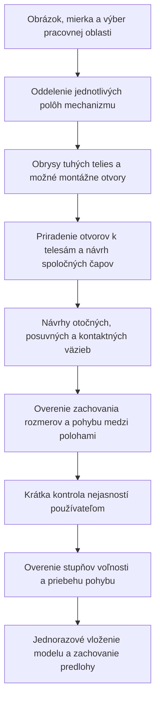

# Návrh mechanicky zmysluplnej detekcie Magic importu

Stav: návrh ďalšej generácie detekcie; nejde o opis už implementovanej AI.
Súčasný lokálny detektor rozpoznáva obrysy, čiary, oblasti a kruhy. Jeho
percento vyjadruje geometrickú zhodu, nie pravdepodobnosť správnej funkcie
mechanizmu. Samotná presnejšia klasifikácia farieb tento problém nevyrieši.

## Navrhovaný postup

1. **Najskôr oddeliť obrázky jednotlivých polôh.** Schéma s „step 1–3“ je
   jeden mechanizmus v troch polohách. Každá poloha má vlastný výrez a
   transformáciu do spoločných súradníc. Nevložiť tri kópie telies.
2. **Rozpoznávať celé tuhé telesá.** Uzavretý obrys je geometria, dlhá čiara
   môže byť hrana, os alebo tiahlo. Rozvetvený obrys sa nemá automaticky
   zmeniť na jednoduché rameno. Prekrývajúce sa členy ponechať ako viac
   hypotéz, kým ich nerozlíšia otvory alebo ďalšia poloha.
3. **Kruhy najprv považovať za možné otvory.** Ku kruhu uchovať zoznam
   možných vlastníkov. Kruh v prekrytí dvoch telies môže označovať spoločný
   čap. Kruh vo vnútri veľkého obrysu rámu ešte nepatrí rámu. Samostatné
   ložisko vytvoriť až po rozlíšení otvor / čap / valček / značka.
4. **Vytvoriť graf telies a spojov.** Návrh každého spoja musí uviesť obe
   telesá, lokálne montážne body, podporujúci dôkaz a alternatívy. Blízkosť
   hrán nestačí na vznik väzby. Stred otvoru je silnejší dôkaz než koniec
   odhadnutej osi či vonkajší roh obrysu.
5. **Overiť pohyb medzi polohami.** Tuhému telesu sa nemenia vzdialenosti
   medzi jeho otvormi. Spoločný otočný bod zostáva spoločný; posuvná väzba
   zachováva smer a relatívny uhol; čap v kulise leží na jej strednici;
   kontakt vačky je jednostranný dotyk s normálou, nie pevná väzba.
6. **Nejasnosti zobraziť ako konkrétne otázky pri náhľade.** Napríklad
   „Tento kruh je otvor ramena alebo samostatný valček?“ a „Ktorá časť
   vedenia je pevná?“ Nenechať používateľa hádať význam desiatok rovnako
   označených kontúr. Každú alternatívu farebne ukázať na predlohe.
7. **Až potom zostaviť a overiť mechanizmus.** Skontrolovať voľnosť,
   nadbytočné alebo protichodné väzby, limity a vzorky celého zdvihu.
   Neúspešný výpočet označiť s konkrétnym spojom a polohou. Nedomýšľať
   pohon, výkon motora ani silu pružiny z jedného obrázka.

## Pravidlá návrhu väzieb

| Pozorovanie | Návrh | Čo musí zostať na overenie |
|---|---|---|
| Zhodné otvory dvoch telies | Otočný kĺb | Vlastníctvo otvorov, spoločná poloha v ďalších snímkach |
| Vozík a priama koľajnica | Posuvná väzba | Pevný vozík / pevné vedenie, smer, zdvih |
| Valček v zakrivenej drážke | Bod na strednici dráhy | Polomer valčeka, šírka drážky a koncové dorazy |
| Plocha alebo valček pri vačke | Jednostranný kontakt | Kontaktná strana, normála, geometria sledovača |
| Súčiastky sa pohybujú spoločne | Možné spoločné tuhé teleso | Zachovanie relatívneho posunu aj uhla vo viacerých polohách |
| Veľký zelený obrys | Obrys s neurčenou funkciou | Farba sama neurčuje rám ani fixáciu |
| Dve pretínajúce sa čiary bez otvoru | Bez automatickej väzby | Priesečník nemusí byť čap |

## Istota a bezpečné vkladanie

Uchovávať oddelene `geometryConfidence`, `ownershipConfidence` a
`jointConfidence`; neistotu nezakrývať jedným percentom. Pri každej hypotéze
uchovať `evidence`, `alternatives`, príslušnú polohu obrázka a potvrdenie
používateľa. Nie sú to nové povinné polia súčasného formátu projektu;
patria do pracovného návrhu importu. Exportovať iba potvrdený model.

Geometriu možno vložiť aj bez potvrdenej mechaniky, ale stav musí byť
„Geometria bez overených väzieb“. Otvory neurčeného vlastníctva nesmú
vytvárať pevné uzly. Všetky zmeny modelu vložiť atomicky ako jeden krok
histórie až po validácii. Pri chybe ponechať náhľad a označiť chybný riadok;
oprava jedného návrhu nesmie zahodiť ostatné. Pozadie zachovať s mierkou,
výrezom a transformáciou; vypínanie predlohy nemení polohu modelu.

## Konkrétne prijímacie scenáre

- **Dvojito sklopený šuflík, tri kroky:** jedna zásuvka, dve samostatné
  kulisy a rovnaké ramená naprieč polohami. Pevný korpus nesmie vlastniť
  všetky kruhy, ktoré sa nachádzajú v jeho vnútornom priestore.
- **Kinka:** rozlíšiť prekrývajúce sa modré telesá podľa obrysov a otvorov.
  Dva odlišné otvory nesmú splynúť len preto, že majú podobnú farbu.
  Červené čiary bez ďalšieho dôkazu neklasifikovať ako pružinu alebo pohon.
- **Samotná fotografia:** umožniť ručné priradenie telesa a montážnych
  otvorov; neoznačiť mechaniku za overenú z jedinej polohy.
- **Vačka a vozík:** správny kontakt sa overí počas otáčky. Vozík nesmie
  preniknúť do profilu ani opustiť koľajnicu; chýbajúci návratový člen sa
  nesmie potichu nahradiť obojstrannou väzbou.
- **Zmena mierky alebo výrezu:** body, otvory, obrysy aj poloha predlohy
  sa transformujú rovnako; pomery dĺžok zostávajú zachované.

Najskôr implementovať vlastníctvo otvorov a explicitné rozlíšenie polôh,
potom graf väzieb a overenie pohybu. Súčasný lokálny detektor ponechať ako
rýchly návrh geometrie. Zložité prekrytia z jediného obrázka nebudú
jednoznačné ani pri sofistikovanejšom modeli; rozhodnutie sa má opierať
o ďalšiu polohu alebo konkrétne potvrdenie používateľa.
