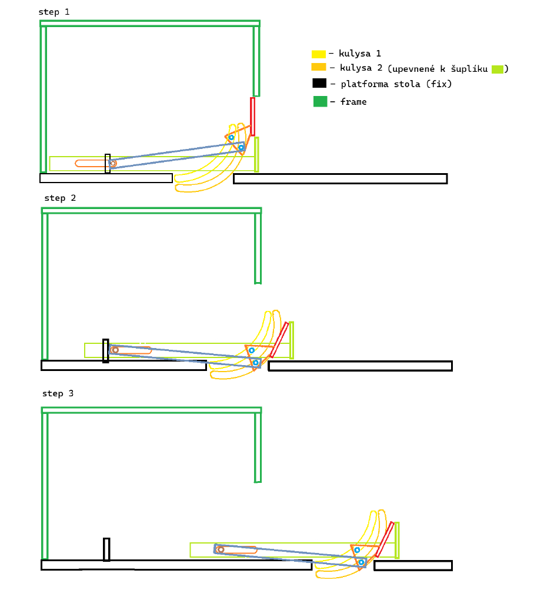

# Dvojite sklopeny suflik

Samostatný projekt v ponuke **Projekty**, oddelený od všeobecných šablón. Nový prehliadač otvorí prázdny editor. Už uložený projekt sa obnoví; otvorenie pripraveného projektu vytvorí nový exemplár, aby neprepísalo predchádzajúce úpravy.

## Čo vyplýva z náčrtu

- Korpus a platforma stola sú pevné.
- Obe zakrivené kulisy sa posúvajú so zásuvkou, čo používateľ potvrdil.
- Modré rameno je tuhé, jeho zdanlivo odlišné dĺžky sú schematické.
- Dve vodiace ložiská A a B majú pevný vzájomný rozstup na držiaku čela.
- Prvá a druhá poloha znázorňujú sklopenie čela a zmenu sklonu ramena. Druhá a tretia poloha majú približne rovnaké uhly a zodpovedajú následnému spoločnému posuvu.

Náčrt nemá kóty. Nedá sa z neho spoľahlivo určiť polomer kulís, dĺžka ramena, uloženie zadného čapu ani výrobné vôle.

## Odhadová geometria

| Veličina | Odhad |
|---|---:|
| Korpus | 390 × 270 mm |
| Zdvih zásuvky | 300 mm |
| Dĺžka modrého ramena R–B | 240 mm |
| Dĺžka čela | 75 mm |
| Uhol čela, zatvorené → sklopené | 90° → 65° |
| Uhol ramena, zatvorené → sklopené | 8° → −5° |
| Koniec sklápania | 60 mm zdvihu |
| Odhadová dĺžka prechodu zadnej opory | 18 mm |
| Rozstup ložísk A–B | približne 25,61 mm |
| Priemer ložísk / šírka drážok | 8 / 12 mm |
| Pevný výrez stola | X = 280–680 mm |

Ložiská majú od päty čela lokálne súradnice A = (2, −35) mm a B = (−18, −19) mm. X smeruje po čele, Y kolmo na čelo. Modré rameno je spojené s ložiskom B. Pri zmene rozmerov sa oba profily regenerujú spoločne.

## Dve fázy

1. **0–60 mm, sklopenie.** Zásuvka a obe kulisy sa posúvajú. Zadný čap R je najprv zachytený pevnou oporou; v odhadovom prechode 42–60 mm sa plynulo odovzdá do posuvu. Rameno a čelo menia uhol.
2. **60–300 mm, posuv.** Čelo, rameno, ložiská, kulisy a zásuvka sa posúvajú spoločne. Uhly aj polohy ložísk voči zásuvke zostávajú konštantné.

Zadný čap má na zásuvke pozdĺžnu drážku s odhadovou dĺžkou 51 mm. Prechod je predpísaný kinematický pohyb s nadväzujúcou polohou a rýchlosťou. **Spôsob zachytenia a uvoľnenia čapu, napríklad západka alebo poddajné uloženie, nie je v náčrte určený.** Model neoveruje sily ani funkciu takej západky. Pri spätnom pohybe používa rovnakú idealizovanú dráhu bez hysterézie.

Medzera v platforme sa na jednotlivých skiciach zdanlivo presúva. Pevná platforma to neumožňuje. Tento projekt preto používa **jeden pevný výrez pre celý zdvih**, nie medzeru, ktorá sleduje ložisko. Veľkosť výrezu je odhad, ktorý treba overiť na skutočnom návrhu.

## Trajektórie a solver

Kulisy sa odvodia z polôh oboch ložísk v sústave zásuvky pri hladkom sklopení čela a ramena. Solver hľadá polohu ložiska B na druhej kulise, ktorá uzavrie tuhú dĺžku ramena so zadným čapom. Prvá kulisa kontroluje druhé ložisko a pevný rozstup A–B. Nezlučiteľné odsadenie profilu sa označí ako blokovanie, nie ako zmena dĺžky ramena.

- **Pevný korpus:** dráhy A a B obsahujú sklopenie aj vodorovný posuv.
- **Zásuvka:** dráhy ležia v jej kulisách; po sklopení sa už nepredlžujú. Na plátne sa vykreslia v aktuálnej polohe zásuvky.
- Graf zobrazuje uhol čela aj modrého ramena a prechod pri 60 mm.
- CSV obsahuje oba uhly, fázu, obe ložiská v oboch sústavách, chybu väzieb a označenie odhadových rozmerov.
- JSON zachová všetky projektové rozmery a pri importe opäť označí model ako odhadový.

Geometrická tolerancia je 0,05 mm. Testy kontrolujú 1 001 polôh, pevné dĺžky, oba profily, kontinuitu prechodu, následný čistý posuv, import aj kolíziu s pevným stolom.

**Ide o odhadový polohový model, nie výrobný výkres ani potvrdenie realizovateľnosti fyzického výrobku.** Profily nemajú overené výrobné vôle, kontaktné sily, opotrebenie či minimálny polomer pre reálne ložiská.
